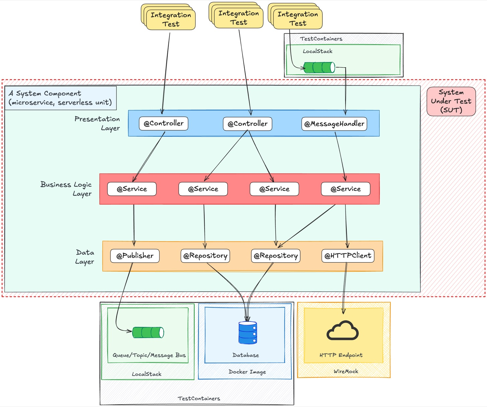

> Originally published on [Substack](https://georgeracu.substack.com/p/your-team-lost-60-hours-last-month) on 3 December 2025.

Your developer starts the day, changes three lines of code, and hits build. Ten minutes pass. They check Slack, scan emails, lose their train of thought. The build finishes. They spot a typo, fix it, rebuild. Another ten minutes vanish.

This isn’t a bad day. This is every day.

Here’s what that actually costs you: 60 developer-hours per month for a team of five. That’s losing an entire developer for more than three weeks every year, watching progress bars fill.

Let’s work through the maths, then I’ll show you how to fix it.

## The Real Cost of Waiting

Take a typical development day. Your developer makes four pull requests. Each one needs:

**Local builds:** Two builds per PR at 10 minutes each = 20 minutes waiting  
**CI/CD pipeline:** One run per PR at 20 minutes = 20 minutes waiting

That’s 40 minutes per PR, 160 minutes per day, per developer.

Scale this across five developers:

- **Local builds:** 2 builds × 10 minutes × 5 developers = 100 minutes daily

- **CI/CD runs:** 4 PRs × 20 minutes = 80 minutes daily

- **Total waiting time:** 180 minutes (3 hours) every single day

Over a month, that’s 60 hours of waiting time for the whole team.

This isn’t just about lost time. Every context switch has a cost. When your developer stops to wait for a build, they lose momentum. Getting back into flow takes 15-25 minutes after each interruption. The creative engine stalls, and restarting it burns more fuel than keeping it running.

## What Happens When You Fix It

Cut your local build time in half, from 10 minutes to 5 minutes. Here’s what changes:

- **Local builds:** 2 builds × 5 minutes × 5 developers = 50 minutes daily (down from 100)

- **CI/CD runs:** Still 80 minutes daily

- **New total:** 130 minutes daily

**Time saved:** 50 minutes per day, which compounds to 16.67 hours per month for the team.

That’s more than two full working days reclaimed. Time your team could spend shipping features instead of watching spinners.

## The E2E Test Trap

Most slow pipelines share a common culprit: end-to-end tests run amok.

E2E tests are the heavyweight boxers of your test suite. They’re powerful but exhausting. Each test requires:

- Full application deployment across multiple microservices

- Database setup with realistic data

- External dependencies mocked or live

- Network calls, authentication flows, the works

A single E2E test takes 1-2 minutes. A suite of 50 tests pushes your pipeline past an hour. Worse, they’re brittle. Change a CSS selector or database schema, and half your E2E suite breaks. Debugging these failures is archaeology as layers of abstraction obscure the actual problem.

Compare this to a unit test: isolated, in-memory, milliseconds to run. Unit tests are precise surgical tools. E2E tests are sledgehammers.

## The Swiss Cheese Model: Layer Your Defence

Don’t abandon E2E tests completely. Instead, adopt the Swiss cheese model from “Clean Code” and “Working Effectively with Legacy Code”. No single layer catches everything, but multiple layers together catch most issues without the overhead.

**Unit tests (80% of your suite):** Test individual functions and classes in isolation. Does your tax calculation method return the right value? Does your validation logic catch invalid input? These run in milliseconds and form your first line of defence.

**Integration tests (15% of your suite):** Verify that your components work together. Use [TestContainers](https://testcontainers.com/) to spin up lightweight MongoDB or PostgreSQL instances. Test that your Spring Boot service correctly saves entities to the database, that your REST controller properly serialises responses. These take seconds, not minutes.

**E2E tests (5% of your suite):** Reserve these for critical user journeys only. User login, checkout flow, payment processing. Limit yourself to the absolute essentials, the workflows that would sink your business if broken.

This distribution gives you confidence without the crippling wait times. Your unit tests catch logic errors instantly. Integration tests verify your components play nicely together. E2E tests confirm the critical paths work end-to-end.

## Tools That Actually Help

**[TestContainers](https://testcontainers.com/)** lets you spin up Docker containers for databases and services during integration tests. Instead of mocking MongoDB, run the real thing in an isolated container. Your tests become more reliable, and you avoid the mock-reality gap.

**[LocalStack](https://localstack.cloud/)** provides local implementations of AWS services. Test your Lambda functions, S3 interactions, and DynamoDB queries without hitting actual AWS infrastructure. This slashes your integration test runtime and eliminates flaky network dependencies.

**[Gradle build cache](https://docs.gradle.org/current/userguide/build_cache.html)** (or Maven equivalent) prevents redundant compilation. Configure it properly, and your incremental builds drop from 10 minutes to under 2.

**Parallel test execution** runs independent tests concurrently. A 20 minute test suite becomes 5 minutes with proper parallelisation. Most modern test frameworks support this out of the box.

## Make the Change

Start measuring your build times today. Track how long developers wait for local builds and CI/CD pipelines. The numbers will shock you.

Then audit your test suite. How many E2E tests do you really need? Can you replace some with faster integration tests? Are you testing implementation details in unit tests that should be tested at integration level?

Optimise your local builds first, as that’s where developers lose focus most often. Then tackle your CI/CD pipeline. Enable caching, parallelise tests, and ruthlessly prune unnecessary E2E tests.

The goal isn’t zero waiting time (impossible), but acceptable waiting time. If your build completes while you refill your coffee, that’s acceptable. If it completes while you’ve reviewed three other PRs, that’s not.

------------------------------------------------------------------------

### Key Takeaways

- Slow pipelines cost a 5 person team roughly 60 hours monthly, that’s more than three weeks of lost productivity per year

- Halving local build times saves ~16.67 hours per month for the team, equivalent to more than two working days

- The Swiss cheese testing model: 80% unit tests, 15% integration tests, 5% E2E tests for critical paths only

- Tools like TestContainers and LocalStack enable fast, reliable integration tests without infrastructure overhead

------------------------------------------------------------------------

How much time is your team losing to slow builds? Track it for one day and multiply by 20. The number might surprise you enough to finally fix it.

What’s your current build time, and what’s stopping you from cutting it in half?
