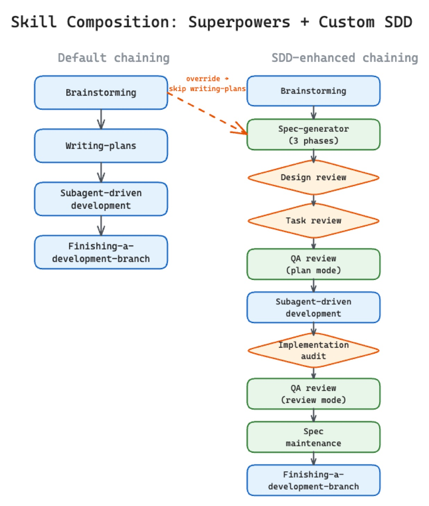
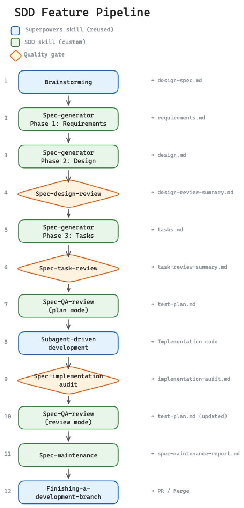
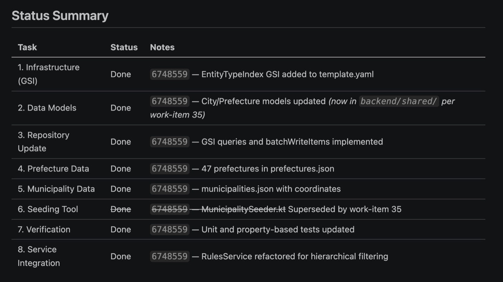
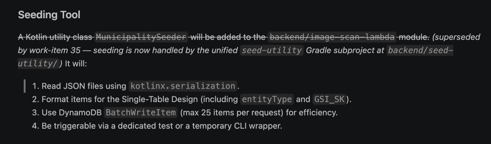
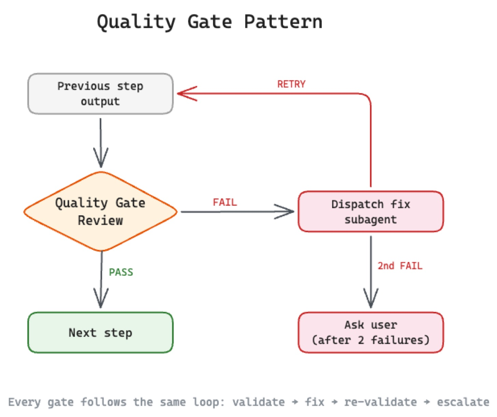

> Originally published on [Substack](https://georgeracu.substack.com/p/why-i-think-that-sdd-is-not-waterfall) on 27 April 2026.

## The Sceptic’s Starting Point

When I started using [Kiro](https://kiro.dev/) for developing [Gomi Bunrui](https://gomi-bunrui.app/app/), I was a bit surprised by Specification Driven Development approach that Kiro had. I never used SDD before and I had a very shallow understanding of what it is. I tried using it a bit and I gave up, especially when I “knew what needs to be done” and Kiro wanted requirements first, then a design document, then a task breakdown. That felt a bit too much before a single line of code. I’ve been writing software for a long time now and my instinct is to explore with code, start with test-first development, sketch something out, run it, see what breaks, refine. Specs-first felt unintuitive and against my way.

Spec Driven Development, at least as Kiro implements it, asked me to spell out requirements, design decisions, and implementation steps before I can touch the codebase. If you’ve internalised the Agile Manifesto’s preference for “working software over comprehensive documentation,” this feels like walking backwards. I’m producing documents instead of producing software so my initial gut reaction was to reject it and to keep doing what I was doing, while still wondering why someone would build an entire IDE around this model. I felt that I was missing something, so I committed to building an entire feature spec-first, following every step Kiro laid out, even when it felt slow, just to experience the flow and see what I was missing.

## The Kiro Experience: Learning by Doing

Kiro’s workflow follows a three-step lifecycle: requirements, design, tasks. Each step produces a markdown document. You don’t move forward until the current document is reviewed, revised, and accepted. I can’t write any code until all documents are complete. It’s structured and deliberate, and at first, deeply frustrating.

This frustration has a name: **dopamine delay**. When I already think I know what I want, the instinct is to start coding immediately so I chase that quick reward of seeing something work. SDD takes that steam right off as it makes me sit down, think, analyse, give feedback on documents instead of debugging runtime errors. The dopamine reward comes much later than you’d expect. By the time I reach implementation, I’ve caught the assumptions I didn’t know I had. The requirements document feels heavy and very similar to bureaucracy and that’s true to some degree and that’s also the place where “I thought I knew what I wanted” becomes “now I actually know what I want”.

I noticed the shift most clearly when the agent finally started writing code, as it followed the spec, having a very well defined recipe to follow. It didn’t wander around for context, it didn’t refactor things I hadn’t asked for as the spec was well structured. When something didn’t match expectations, I could point at a specific line in the design document and say “this is wrong.” That conversation was more productive than I thought initially.

Something that clicked for me after using SDD for a while is that implementation is better structured, can be traced down to actual requirements and I (and the agents) can learn over time how to tune this process to work better. Initially it felt like it was slowing me down, but it also builds enough trust in the plan that I can let go of the implementation. I review the requirements, the design, the tasks and once I’m happy, I hand it to the agent and it executes.

The *handoff* is the part waterfall sceptics point to, the moment it looks like throwing documents over a wall. To me, it feels like briefing a team member I trust with implementation that I don’t need to check implementation to the smallest detail.

I won’t pretend that every spec I wrote was good, as I was new to this model and some specs were vague while others missed edge cases the agent later stumbled on. But even the poor specs gave me something to revise, a concrete artefact to improve rather than a half-built feature to untangle. After implementation, they also gave me an audit trail of what was implemented so far.

At some point I ran out of Kiro tokens mid-project (what can I say, bad luck). [Gomi Bunrui](https://gomi-bunrui.app/app/) had 31 specs by that point, the workflow was working fine and the tool was gone. What do you do when the tool disappears but the habit sticks? Buy Kiro tokens? Not this time, as I already had access to other LLM subscriptions, as described in this [post](/blog/articles/building-gomi-bunrui-part-1/).

## Going Portable: Life After Kiro

So I had a choice: wait for more tokens, buy more tokens, find another commercial tool, or build my own. Like most people do, I chose to build my own.

I tried GitHub’s [spec-kit](https://github.com/github/spec-kit) first. It’s a solid project, but it was too heavy for how I work. The token cost was steep, the ceremony was rigid, and the abstractions didn’t match the lightweight feel I’d got used to inside Kiro. I couldn’t keep up with token consumption so moved on quickly. Maybe this project has improved, I tried it a couple of months ago.

What I realised was that weeks inside Kiro’s workflow had taught me the pieces and all I needed was the *pattern*. So I started building individual skills: small, composable markdown files that any agent can load as instructions. Each one captures a single phase of my SDD lifecycle (more on this soon).

I didn’t need to build everything from scratch as I already had a set of general-purpose agent skills, things like brainstorming, subagent-driven development, and branch finishing, that I’d been using across projects. These skills solve problems that aren’t specific to SDD: how to explore intent before committing to a direction, how to dispatch parallel agents for independent tasks, how to close out a branch cleanly. They’re part of a collection called [superpowers](https://github.com/obra/superpowers): portable skills that work with any agent that can read markdown. Have a look, they are a solid starting point and I use them every they. A bit token hungry, but hey, there’s no free lunch.

What I needed were SDD-specific skills that could slot into the gaps between those general-purpose ones. Skills that understood requirements documents, design reviews, task breakdowns, quality gates, the way I needed them to. So I built seven of them:

- **Spec-generator** is the workhorse. Three phases: requirements, then design, then tasks, each one building on the last. For bugs, it collapses into a single pass.

- **Spec-design-review** is the first quality gate: does the design actually cover every requirement? Is the architecture consistent with what’s already in the codebase? Critical issues block the pipeline.

- **Spec-task-review** is the second gate: every acceptance criterion needs a task, the sequencing needs to be right, and mandatory ending tasks like E2E tests and documentation updates need to be present.

- **Spec-QA-review** runs twice: before implementation it produces a five-layer test plan, after implementation it audits actual coverage against that plan and reports gaps.

- **Spec-implementation-audit** verifies that the finished code matches the spec. It pastes build output as proof.

- **Spec-maintenance** keeps the collection alive. After a feature lands, it searches previous specs for anything superseded and annotates them with cross-references. This is how I keep my specs current instead of fossilising.

- **Spec-workflow** is the orchestrator: which skill runs when, what each one produces, where the override rules live.

Then I wired them together with three reused superpowers skills:

- **Brainstorming** explores intent, proposes approaches, and gets design approval before anything else happens.

- **Subagent-driven-development** dispatches a fresh agent per task, with a two-stage review: spec compliance first, then code quality.

- **Finishing-a-development-branch** handles the merge, PR, or cleanup at the end.

The composition is where it got interesting. The superpowers skills don’t know about SDD as they have their own flow. The spec-workflow skill overrides the default chaining rules so that SDD-specific gates run between the general-purpose steps. After brainstorming finishes, the agent would normally invoke a planning skill. The override says: invoke spec-generator instead. After subagent-driven development finishes, the agent would normally finish the branch. The override says: run the implementation audit first. The general-purpose skills do what they’ve always done, while the SDD skills add the discipline layer on top.

Simplified ASCII:

     ○ Brainstorming                       superpowers (reused)
     │
     │  ╔════════════════════════════╗
     ├──║ override: spec-generator   ║     (default: write-plan)
     │  ╚════════════════════════════╝
     │
     ● Spec-generator                      SDD skill
     │  reqs → design → tasks
     │
     ◆ Spec-design-review                  quality gate
     ◆ Spec-task-review                    quality gate
     ● Spec-QA-review (plan)               SDD skill
     │
     ○ Subagent-driven dev                 superpowers (reused)
     │
     │  ╔════════════════════════════╗
     ├──║ override: run audit first  ║     (default: finish-branch)
     │  ╚════════════════════════════╝
     │
     ◆ Spec-implementation-audit           quality gate
     ● Spec-QA-review (review)             SDD skill
     ● Spec-maintenance                    SDD skill
     │
     ○ Finish branch                       superpowers (reused)

A skill file is nothing exotic. It’s plain markdown with instructions (check specification for [AgentSkills](https://agentskills.io/specification)):

    # Brainstorming
    Explore the user's intent. Propose 2-3 approaches.
    Get explicit design approval before proceeding.

As simple as that: no framework, no runtime, no vendor lock-in. These skills work with Claude Code, Gemini CLI, or whatever agent you prefer. SDD became *portable*, decoupled from any single tool and allowed me to use several coding agents and achieve similar results.

I also added a condensed pipeline for bugs: a shorter path that skips the full requirements ceremony and quality gates, jumping straight to diagnosis and fix.

## The Audit Trail: Specs as Living Documents

In waterfall, the spec is written once and thrown over a wall for someone else to implement it. The document fossilises the moment it leaves the author’s hands and any change is almost impossible or very expensive to make. This workflow is different as specs change with the code, because they’re part of the same feedback loop.

Gomi Bunrui has 67 specs now. When I read them in sequence, they tell the project’s story: backend initialisation, guest access, externalising AWS Bedrock prompts to configuration files. These specs aren’t immutable artefacts, as they’re maintained, so they are more like living documentation. When a new spec changes behaviour that an older spec documented, the older spec gets updated. The collection is always current, never a graveyard of outdated intentions.

A concrete example: Spec 34 designed a data seeding tool inside one of the AWS Lambda handlers. When Spec 35 extracted that tool into a standalone utility and moved shared data models to a new module, the maintenance skill found the affected lines in Spec 34’s design and task documents and annotated them as superseded, with cross-references to the new spec. I find this very useful as an automated audit trail that keeps the collection updated.

That’s really important for me, as when I come back after a week away I don’t have to reconstruct what was implemented by trawling through git history. The specs tell me: what was the requirement, what was the design, what tasks were executed. Agent memory, which I’ve written about in earlier posts, handles session context. Specs handle *project* context as they’re complementary layers of the same knowledge system.

There’s a maintenance loop that keeps all of this useful. Every task implementation gets a git commit. Context gets compacted regularly to keep the agent focused on what’s relevant. All specs are indexed with [qmd](https://github.com/tobi/qmd) for semantic search, so I can query across the full collection rather than remembering which spec covered what. Specs became a queryable knowledge base that grows with the project. There’s a limitation here: any autonomous coding agents (e.g., [Google Jules](https://jules.google/)) that do not have access to my qmd collection cannot take advantage of that feature. I will look into this at some point.

The Agile Manifesto says “working software over comprehensive documentation”. I think that these specs aren’t comprehensive documentation. In the current day and age, they’re the minimum structure needed to trust an agent with my codebase, especially when doing mostly unsupervised implementation.

What does that trust look like end to end?

## The Pipeline: One Feature, Start to Finish

Let me walk through a real one: Gomi Bunrui’s classification prompts were hardcoded in an AWS Lambda handler. Every time I wanted to tweak how the model responded, I had to redeploy the whole backend. A feature came naturally: externalise those prompts to configuration files so I could iterate on them without touching code.

**Step 1: Brainstorming (superpowers skill).** I described the intent conversationally: “Bedrock prompts are baked into the Lambda. I want them in config files, versioned separately, so I can change classification behaviour without a deploy.” The agent didn’t start coding. It asked questions. Where should the config files live? Should they be per-municipality or shared? What happens if a config file is missing at runtime: fail hard or fall back to a default? We went back and forth. It proposed three approaches, I pushed back on one that introduced too much indirection, and we landed on a design I was comfortable with. No code so far.

**Steps 2-3: Spec-generator, phases 1 and 2.** The approved brainstorm became input for the `spec-generator`. Phase 1 produced a requirements document: user stories with acceptance criteria in EARS notation, each one numbered for traceability. Phase 2 produced a design document: components, data models, API contracts, all traced back to specific requirements. The agent read existing codebase patterns before generating, so the design was consistent with what was already there rather than inventing new conventions. No code so far.

**Step 4: Spec-design-review (first quality gate).** The design review skill checked every requirement had design coverage, that the proposed API was consistent with existing endpoints, and that security concerns were addressed. It flagged one major issue: the design didn’t specify what happened when a config file referenced a non-existent municipality. That gap would have surfaced as a runtime bug three steps later but now it got fixed in a document edit that took two minutes. Still no code.

**Step 5: Spec-generator, phase 3.** With the design approved, phase 3 produced a task breakdown: numbered implementation steps, each traced to specific requirements, ordered so that dependencies were respected (API schema updates before handler code, backend before frontend). Still no code.

**Step 6: Spec-task-review (second quality gate).** The task review validated coverage: every acceptance criterion had a task, mandatory ending tasks were present (E2E tests, documentation updates, final validation), and sequencing was correct. Once it passed, the brainstorm document was deleted, its job was done. Still no code.

**Step 7: Spec-QA-review, plan mode.** Before any code was written, the QA review produced a test plan covering five layers: unit tests for individual functions, integration tests for service boundaries, end-to-end tests for user journeys, performance budgets, and security checks. This plan would be revisited after implementation. Still no code.

**Step 8: Subagent-driven-development (superpowers skill).** A fresh agent picked up each task, wrote the test first, then the implementation, ran verification, and committed. Each step built on a known-good state. If something broke, I could roll back one commit and stand on solid ground.

**Step 9: Spec-implementation-audit (third quality gate).** After all tasks were complete, the audit verified that every requirement had corresponding code, that API contracts matched the design, that edge cases were handled, and that documentation was current. It pasted build output as proof. This is where “trust but verify” becomes literal: the agent showed its work.

**Step 10: Spec-QA-review, review mode.** The same QA skill ran again, this time auditing actual test coverage against the plan from step 7. It found one gap: a missing integration test for the config-file-not-found fallback path. A targeted fix agent wrote the test, and the review passed.

**Step 11: Spec-maintenance.** The new feature changed how prompts were loaded, which meant two older specs (the original Lambda handler spec and the Bedrock integration spec) had stale information. The maintenance skill found them, annotated the affected sections with cross-references to the new spec, and produced a report. Those older specs were now current again.

**Status Summary updated for tasks for Spec 34:**

Let me walk through a real one: Gomi Bunrui’s classification prompts were hardcoded in an AWS Lambda handler. Every time I wanted to tweak how the model responded, I had to redeploy the whole backend. A feature came naturally: externalise those prompts to configuration files so I could iterate on them without touching code.

**Step 1: Brainstorming (superpowers skill).** I described the intent conversationally: “Bedrock prompts are baked into the Lambda. I want them in config files, versioned separately, so I can change classification behaviour without a deploy.” The agent didn’t start coding. It asked questions. Where should the config files live? Should they be per-municipality or shared? What happens if a config file is missing at runtime: fail hard or fall back to a default? We went back and forth. It proposed three approaches, I pushed back on one that introduced too much indirection, and we landed on a design I was comfortable with. No code so far.

**Steps 2-3: Spec-generator, phases 1 and 2.** The approved brainstorm became input for the `spec-generator`. Phase 1 produced a requirements document: user stories with acceptance criteria in EARS notation, each one numbered for traceability. Phase 2 produced a design document: components, data models, API contracts, all traced back to specific requirements. The agent read existing codebase patterns before generating, so the design was consistent with what was already there rather than inventing new conventions. No code so far.

**Step 4: Spec-design-review (first quality gate).** The design review skill checked every requirement had design coverage, that the proposed API was consistent with existing endpoints, and that security concerns were addressed. It flagged one major issue: the design didn’t specify what happened when a config file referenced a non-existent municipality. That gap would have surfaced as a runtime bug three steps later but now it got fixed in a document edit that took two minutes. Still no code.

**Step 5: Spec-generator, phase 3.** With the design approved, phase 3 produced a task breakdown: numbered implementation steps, each traced to specific requirements, ordered so that dependencies were respected (API schema updates before handler code, backend before frontend). Still no code.

**Step 6: Spec-task-review (second quality gate).** The task review validated coverage: every acceptance criterion had a task, mandatory ending tasks were present (E2E tests, documentation updates, final validation), and sequencing was correct. Once it passed, the brainstorm document was deleted, its job was done. Still no code.

**Step 7: Spec-QA-review, plan mode.** Before any code was written, the QA review produced a test plan covering five layers: unit tests for individual functions, integration tests for service boundaries, end-to-end tests for user journeys, performance budgets, and security checks. This plan would be revisited after implementation. Still no code.

**Step 8: Subagent-driven-development (superpowers skill).** A fresh agent picked up each task, wrote the test first, then the implementation, ran verification, and committed. Each step built on a known-good state. If something broke, I could roll back one commit and stand on solid ground.

**Step 9: Spec-implementation-audit (third quality gate).** After all tasks were complete, the audit verified that every requirement had corresponding code, that API contracts matched the design, that edge cases were handled, and that documentation was current. It pasted build output as proof. This is where “trust but verify” becomes literal: the agent showed its work.

**Step 10: Spec-QA-review, review mode.** The same QA skill ran again, this time auditing actual test coverage against the plan from step 7. It found one gap: a missing integration test for the config-file-not-found fallback path. A targeted fix agent wrote the test, and the review passed.

**Step 11: Spec-maintenance.** The new feature changed how prompts were loaded, which meant two older specs (the original Lambda handler spec and the Bedrock integration spec) had stale information. The maintenance skill found them, annotated the affected sections with cross-references to the new spec, and produced a report. Those older specs were now current again.

**Status Summary updated for tasks for Spec 34:**

**Design document updated for Spec 34:**

**Step 12: Finishing-a-development-branch (superpowers skill).** The branch was merged with a clean PR.

Four quality gates caught issues that would have been bugs, the design review found a missing error case, the task review ensured nothing was forgotten, the implementation audit proved the code matched the spec and the QA review found a coverage gap. None of these were dramatic saves when discovered early, before shipping to production.

For bugs, the path is shorter. The condensed pipeline skips the gates: spec-generator produces a bugfix spec, design, and tasks in one pass, subagent-driven development implements the fix, and the branch finishes. No need for the whole flow.

Three things hold this together quietly: git commits per task mean every rollback lands on a working state; qmd indexing lets a new agent search existing specs before proposing something that contradicts an earlier decision; context compaction keeps long sessions sharp, so the agent at step twelve is as focused as the agent at step one.

The whole feature, from “I want to externalise prompts” to a merged branch with passing tests, took about two hours. Most of that was thinking, not typing.

## The Practice: What It Actually Is

SDD isn’t for everything, as bugs get a condensed spec, exploratory spikes skip it entirely. Some tasks just need me to open a file and fix the thing.

What it is, at its core, is a way to think before I build. I write down what I want, I review a design that addresses it, then I hand it to an agent and let the trust handoff do its work. I’ve already done the hard part: deciding what “right” looks like. I’ve got used to the dopamine coming later than expected, but it comes with confidence attached.

If your workflow looks anything like mine, all AI agents and straight to code, try one feature with a spec first. Write the requirements, review the design, then hand it over. Let me know how much you trust the result.

I’m still refining this, as the skills will change, the tools will change, the agents will get better or worse or weirder. But the practice of thinking first, capturing that thinking in a spec, and using it to hold both myself and the agent accountable: that’s something that’s worth investing in more.

I admit that this is not vanilla SDD, this feels like a custom development flow that relies on SDD, and that’s true. What I also feel is that this is not waterfall, not even close to it.

------------------------------------------------------------------------

## Glossary

**SDD (Spec Driven Development)**: A development approach where requirements, design, and implementation tasks are documented before code is written. The spec becomes the source of truth for what should be built.

**Spec (in this workflow)**: A set of markdown documents capturing a feature’s requirements, design decisions, and implementation tasks. Unlike traditional specs, these are maintained continuously and updated when the codebase changes.

------------------------------------------------------------------------

## Related Posts

- [I Used 8 AI Tools to Build and Ship a Product Solo, in my Spare Time. Here’s the Honest Breakdown.](/blog/articles/building-gomi-bunrui-part-1/)

- [Building the Agent Memory System: The Setup Guide](/blog/articles/building-agent-memory-system/)

*Part of the Gomi Bunrui series.*
