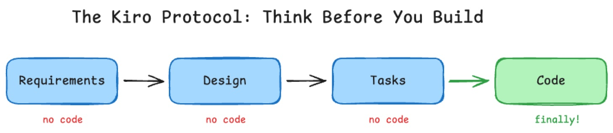
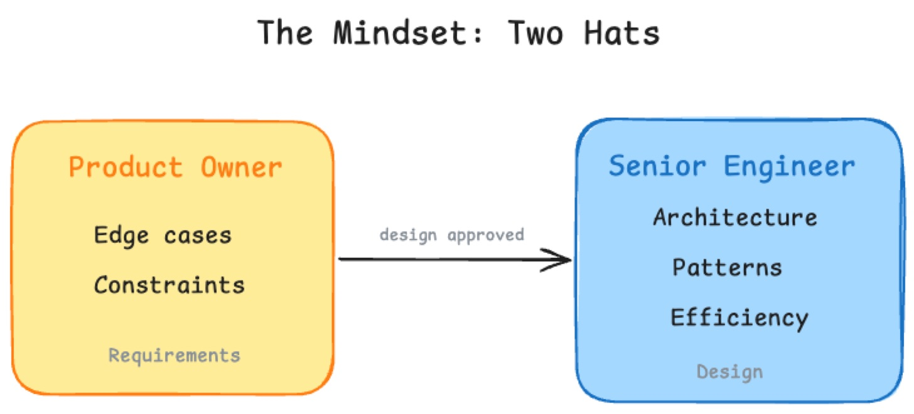

> Originally published on [Substack](https://georgeracu.substack.com/p/kiro-spec-driven-workflow) on 2 May 2026.

In my [last post](/blog/articles/why-i-think-that-sdd-is-not-waterfall/), I wrote about Spec-Driven Development as a practice: why I was sceptical, how I came around, and what happened when I built a portable version of the workflow after running out of tokens.

This post is about [Kiro](https://kiro.dev/), the tool that brought SDD to my practice: the specs it produced, the automation hooks I built around it, and what it actually felt like to hand my project management to an AI for eight weeks (willingly, for the most part).

If you haven’t read SDD Is Not Waterfall, start there. This one goes deeper into the tooling.

## The Wandering AI

I’ve seen many people flagging this issue: they’re working with a brilliant AI coding assistant and they ask for a simple change. Add a delete button to this row, they say. The agent leaps into action: it adds the button, it refactors the entire state management system, changes the CSS naming convention, and starts fixing bugs in the API that weren’t actually bugs.

Suddenly, they’re ten files deep in a pull request they didn’t want, trying to untangle a web of one more thing refactors.

I call this the wandering AI. These tools are fast, maybe too fast, and most of the times very eager to write code (I’m still to figure that one out). They lack the restraint of a senior developer who asks, *wait, do we actually need to change the API for a button?* They’re brilliant coders, but they’re terrible project managers (at least in my experience).

Many times is feels that the problem it’s the momentum. When you give a coding agent a vague instruction, it fills the gaps with assumptions. Once the code starts flowing, the context window fills with implementation details rather than requirements, and by the time you realise the agent has gone down a rabbit hole, the cost of backtracking is high (think about running out of tokens and waiting for the counter to reset).

To build something complex solo, I needed a speed bump. I needed a way to force the AI to stop and think, in markdown, before it ever touched a line of code.

## The Protocol

I covered Kiro’s three-step lifecycle in the [SDD post](/blog/articles/why-i-think-that-sdd-is-not-waterfall/): requirements, design, tasks. What I didn’t convey is how it *feels* to use it.

I describe what I want, then I wait. The AI doesn’t code, it asks me questions about edge cases, data persistence, UX constraints etc. I answer them in markdown. Then it generates an architectural blueprint, file changes, API contracts. I review it. Finally, it generates a precise task list with specific file paths and implementation steps. No code up to this point.

By the time an AI agent starts typing code, it’s executing a plan that’s already been validated, with less guessing and more confidence. If the requirements were wrong, I would fix them in step two, in a markdown file, not in application code.

This decoupling is what makes it work for me: it separates the *what* (product management) from the *how* (software engineering). The spec becomes the source of truth that survives across multiple AI sessions and multiple different AI tools. I could start a feature in Kiro, then hand the task list to Claude Code or Gemini CLI, and they’d have the same context.

## The Audit Trail

Over eight weeks, Kiro produced 31 numbered specs. Each folder contains three markdown files: requirements, design, and tasks. Reading them in sequence, from 01-backend-initialisation to 30-backend-guardrails, is basically the story of the entire project.

    ai-ideas/gomi-bunrui-aws/.kiro/specs/
         ├── 01-backend-initialization
         ├── 02-backend-multi-lambda-structure
         ├── 03-early-access-backend
         ├── 04-email-confirmation
         ├── 05-email-unsubscribe
         ├── 06-email-template-formatting-bugfix
         ├── 07-image-classification-lambda
         ├── 08-externalize-bedrock-prompt
         ├── 09-frontend-implementation
         ├── 10-end-to-end-classification
         ├── 11-individual-deployment-workflows
         ├── 12-api-documentation
         ├── 13-privacy-policy-page
         ├── 14-settings-page
         ├── 15-api-cognito-authentication
         ├── 16-httpmethod-null-bugfix
         ├── 17-smoke-test-authentication-endpoints
         ├── 18-remove-lambda-rate-limiter
         ├── 19-scan-results-screen
         ├── 20-terms-of-service-page
         ├── 21-landing-page-redesign
         ├── 22-unified-website-pwa-deployment
         ├── 23-scanning-progress-page
         ├── 24-splash-screen-onboarding
         ├── 25-camera-home-screen
         ├── 26-registration-screen
         ├── 27-login-screen
         ├── 28-reset-password-flow
         ├── 29-e2e-post-release-tests
         ├── 30-backend-guardrails

This is a developer’s save game, additional to being an audit trail and documentation. If a feature breaks three weeks later, I don’t have to guess why I implemented it that way, I open the corresponding spec and I will find out.

A few examples show what this looked like in practice.

**Spec 01: Setting the standard.** The first spec covered backend initialisation: the Kotlin/http4k project structure, Gradle build with JDK 21, the core REST endpoints (`/classify`, `/cities`, `/rules/{cityId}`, `/schedule/{cityId}`), AWS Bedrock integration for image classification, and DynamoDB for municipal rules and schedules. Because this was codified in the first spec, every subsequent one had a pattern to follow. The AI tools didn’t have to discover the architecture, as it was already there.

**Spec 26: Managing complexity.** By Spec 26, I was building the registration screen: social authentication via Google and Apple, email/password fallback, terms acceptance, and a handoff into municipality selection, all integrated with AWS Cognito. A coding agent given this task without context would probably have missed an edge case or broken a security rule. But Kiro’s requirement phase forced me to decide exactly what a new user’s journey looked like before a single line of code was written. The design document mapped those decisions to specific files. What could have been a high-risk cross-cutting change became a series of small, low-risk tasks.

    gomi-bunrui-aws/.kiro/specs/26-registration-screen
         ├── design.md
         ├── requirements.md
         └── tasks.md

**Spec 30: Codifying safety.** The later specs showed how the system matured. Spec 30 added backend guardrails: detecting when the LLM intentionally rejects a scan (inappropriate content, prompt injection, unrecognisable images, hazardous items), emitting structured CloudWatch logs and custom metrics per rejection type, and triggering alarms when rejection rates spike above defined thresholds. In many projects, guardrails are an afterthought bolted on after the first security audit. Because the spec workflow treated guardrails as a first-class feature, they got the same treatment as everything else: requirements, design, tasks. Every guardrail decision was documented before it was implemented. No shortcuts, no we’ll add tests later.

Having these specs as persistent, human-readable files meant the project’s memory wasn’t trapped in a single LLM session. It was committed to the repo and available to any agents that will pick-up work on next iteration.

## The Frictionless Hook

Having a protocol is one thing, and following it at midnight when I just want to ship a fix is another. I built three custom Kiro hooks that automated the friction out of the process.

**Spec sequence numbering.** When you build 31 features, counting becomes a chore. I wrote a hook that automatically detected the next available number in the work items directory. When I started a new feature, the hook would create the next numbered folder and scaffold the requirements markdown. It sounds small, but removing that tiny bit of admin friction meant I never hesitated to start a new spec.

**Conventional commit enforcement.** The hardest part of solo development is maintaining a clean git history. I linked Kiro’s active spec to a commit hook. Every commit generated by an AI agent was automatically tagged with the active spec number and followed the conventional commit convention: feat, fix, docs. The result is a repo where every single commit traces back to a specific design decision in a specific spec. Conventional commits are useful during release as it will automatically bump software version and release tags for each project.

    commit 10109d4b48d46db252eaabcac4526c1fad971df5
    Author: George Racu <author@example.com>
    Date:   Fri Mar 6 22:53:27 2026 +0900

        feat(registration): add /register route and authentication guard

        - Add /register route to React Router configuration
        - Authentication guard redirects authenticated users to /home
        - Add Property 13 test: authenticated user route guard
        - Verify unauthenticated users can access registration screen
        - All 19 property tests passing

        Validates: Requirements 5.7, 5.8

    commit beff6d04e0493545fc40ff048b5cd4227f110101
    Author: George Racu <author@example.com>
    Date:   Fri Mar 6 22:43:27 2026 +0900

        feat(registration): enhance accessibility with ARIA labels and keyboard navigation

        - Add role attributes (form, main, banner, contentinfo) to semantic elements
        - Add aria-label to registration form for screen readers
        - Associate checkbox label with input using htmlFor and useId
        - Add formLabel translation key for English and Japanese
        - Fix TermsCheckbox to use proper label association instead of onClick
        - Update test mocks to include translation function
        - All 178 registration tests passing

        Implements task 8 (subtasks 8.1-8.2) of registration-screen spec
        Requirements: 6.7, 6.8, 6.10
        
    commit feee9bfd9783e5c78cd6da10fec9349081ff1a0f
    Author: George Racu <author@example.com>
    Date:   Fri Mar 6 22:36:41 2026 +0900

        feat(registration): implement bilingual support with i18n

        - Add English and Japanese translations for all UI text, validation errors, and API errors
        - Integrate language preference from localStorage with automatic persistence
        - Update RegistrationScreen, SocialLoginButton, and TermsCheckbox to use translation keys
        - Add error message mapping to translation keys in RegistrationScreen
        - Implement property-based tests for bilingual error messages, UI text, and language persistence
        - All 17 property tests passing including new bilingual support tests

        Validates: Requirements 7.7, 8.1-8.7

**Smoke test analysis.** This one had a mind of its own. Whenever a spec’s design document changed, this hook triggered an LLM-powered check: based on these architectural changes, do we need to update our post-deploy smoke tests? If the answer was yes, it added a task to the spec’s task list to update the Playwright scripts.

These hooks turned good intentions into defaults, as the project stayed clean even when I was moving fast.

## The Mindset: Two Hats

Working this way requires a mental shift. I’m no longer just a developer talking to a coding tool. I’m alternating between two personas: the Product Owner and the Senior Engineer.

In requirements mode, my job is to be the customer. I shouldn’t be thinking about React hooks or database schemas yet. I should be thinking about value, edge cases, and constraints. When Kiro asks, What happens if a user scans an item but has no internet connection? it’s forcing me to be a PM. The prompts I write here aren’t technical, they’re conceptual: The app should cache the scan result locally and sync when back online. I am defining the *what*.

Once the requirements are locked and I move to design, I switch hats. Now I’m the Senior Engineer overseeing an AI junior. I review the design document not for features, but for fit. Does this change break existing patterns? Is this the right way to use our Lambda functions?

Most AI coding failures happen because we try to be both personas at once in a single prompt. We ask for a feature and an implementation in the same breath. Splitting them gives the AI, and myself, the room to do both well.

The surprise is that AI pushback becomes my favourite feature. When I gave a vague requirement, Kiro pushed back with clarifying questions. At first, it felt like a delay, but by Spec 10, I realised it was a safeguard as questions Kiro asked were bugs that didn’t happen later.

## The Honest Bits

This workflow wasn’t free. Over the course of the project, I used roughly 2,600 Kiro credits. In exchange, I got 31 fully documented features, an automated audit trail, and zero major architectural regressions. For a solo developer, that’s a bargain, I would say.

There was some friction, I will admit that. I won’t pretend I followed these rules every single time. There were late nights where I just wanted to fix a CSS bug (a three-line change, surely that doesn’t need a spec) and I bypassed the process entirely. I call these my cheating sessions. Every time I did it, I regretted it later when I had to manually update the documentation to match the code. Not quite manually, but pointing my agent to the change and why it was needed, it felt like I should have done it right from the beginning.

The biggest challenge is context switching. Moving from thinking in markdown to executing in code requires a mental reset. There were times when the spec got slightly out of sync with a quick fix I’d made manually, and I’d spend ten minutes realigning them. The protocol requires discipline, and discipline is hard when you’re tired.

The second challenge is weight. By Spec 30, the directory was large. While the AI tools handled it fine, a human reading the whole thing for the first time would be overwhelmed. I learned to keep requirements lean: focus on the *what* and leave the *how* to the design phase.

What would I change? Shorter requirements documents. More frequent task list updates during implementation. And I’d build the hooks from day one instead of adding them at Spec 10. But hey, we learn every day and that’s what matters.

## What Happened Next

Well, I ran out of tokens. The workflow was working, the tool was gone, and the habit stuck. What I did next, building a portable version of this workflow using plain markdown skills, is the story I told in [SDD Is Not Waterfall](/blog/articles/why-i-think-that-sdd-is-not-waterfall/). That post covers how the 31 Kiro specs became 67 total specs, written across multiple AI tools using a workflow that doesn’t depend on any single product.

But the foundation was here. Kiro taught me something I wouldn’t have learned from documentation or tutorials: the discipline of thinking before building, and the value of giving an AI agent a job description instead of a blank canvas.

If you’re building anything more complex than a weekend prototype with AI, try one feature with a spec first. Write the requirements, review the design, then hand it over. See how much you trust the result.

Share your experience of using Kiro and SDD, I am keep to hear other people’s opinion on this topic and what I missed.

------------------------------------------------------------------------

*Gomi Bunrui is live at [gomi-bunrui.app](https://gomi-bunrui.app/). You can read the full competition article on [AWS Builder Center](https://builder.aws.com/content/3Ao3pYCt3LOf4G4Ju8Ct7V5a9O6/aideas-gomi-bunrui).*

*Series: [Part 1: I Used 8 AI Tools to Build and Ship a Product Solo](/blog/articles/building-gomi-bunrui-part-1/) · [SDD Is Not Waterfall](/blog/articles/why-i-think-that-sdd-is-not-waterfall/) · [The Jidoka Principle](/blog/articles/jidoka-for-ai-assisted-coding/) · [AI Agents That Remember](/blog/articles/ai-agents-that-remember/) · [Building the Agent Memory System](/blog/articles/building-agent-memory-system/)*

*Follow: [Substack](https://georgeracu.substack.com/) · [LinkedIn](https://www.linkedin.com/in/george-racu-70670443) · [X](https://x.com/Georgeracu)*
