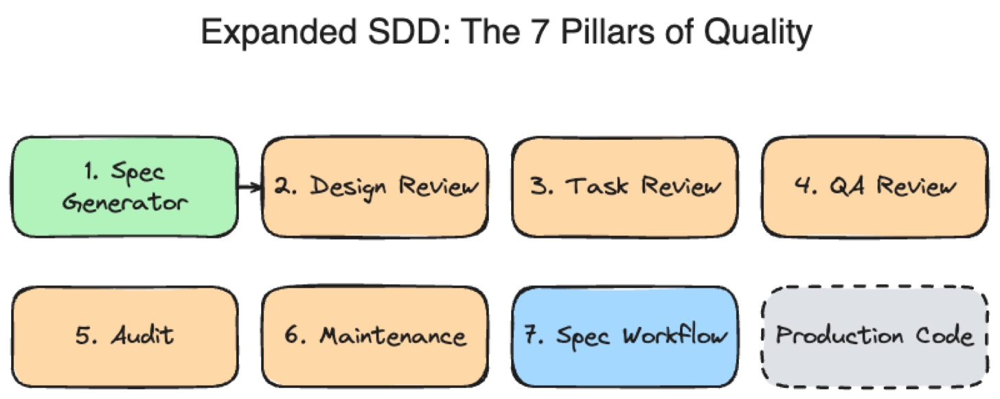
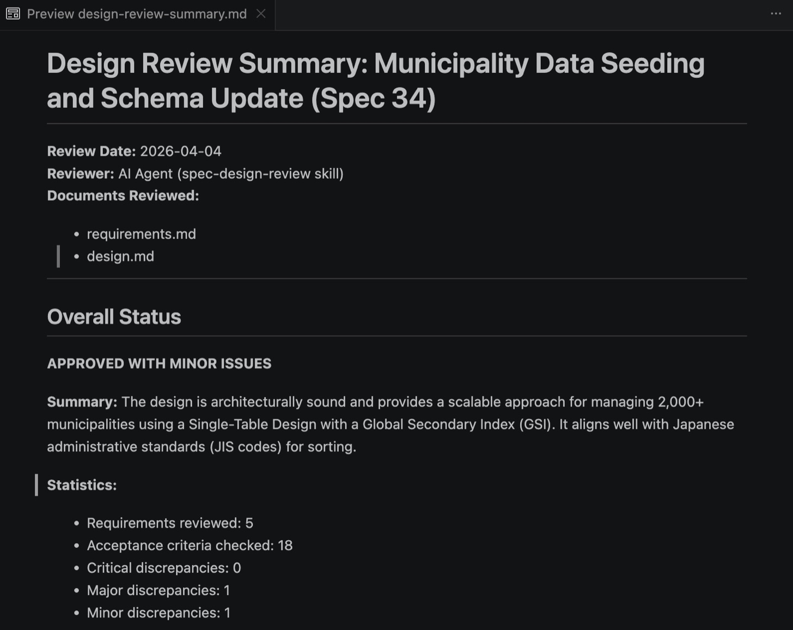
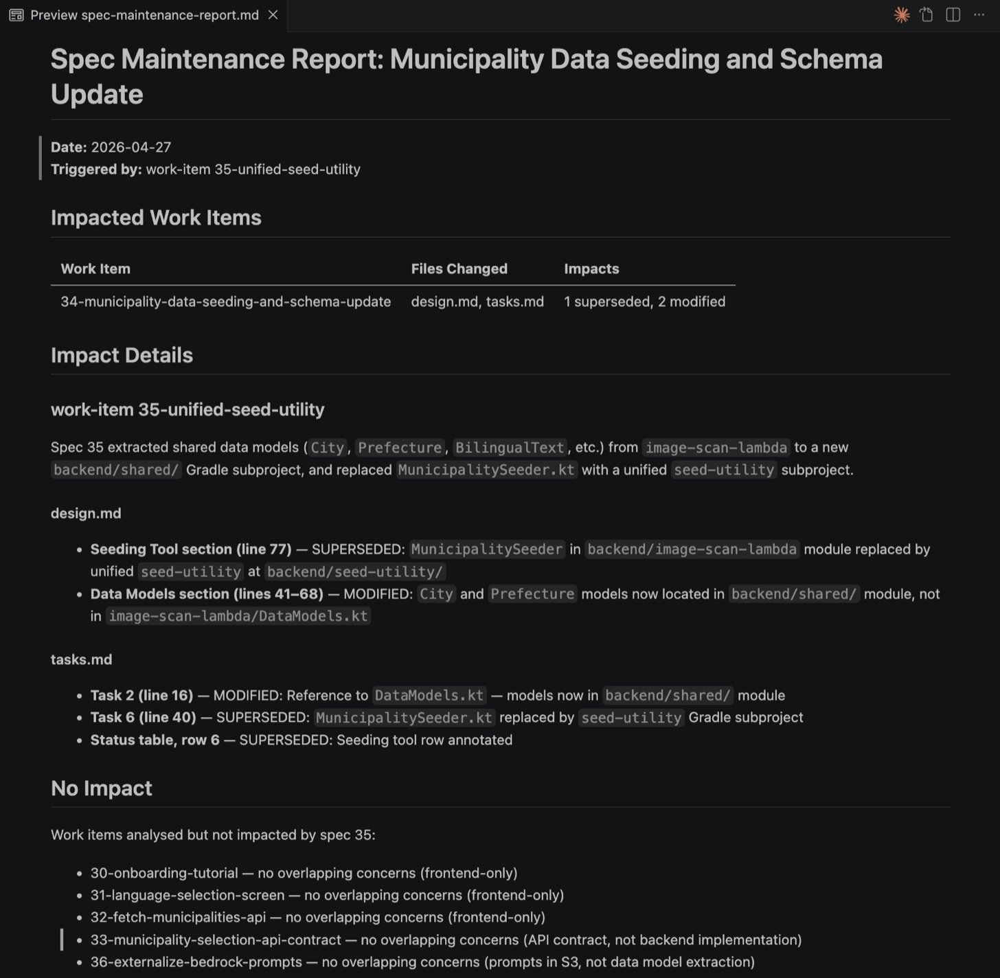
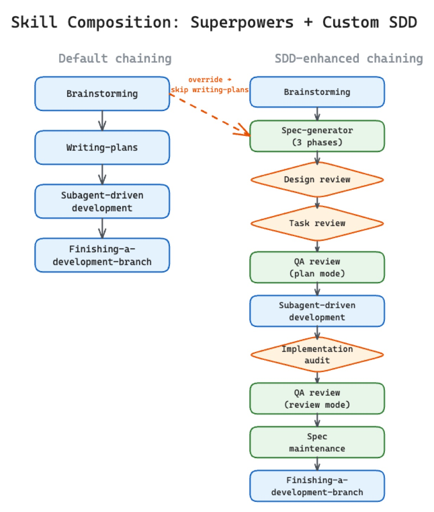
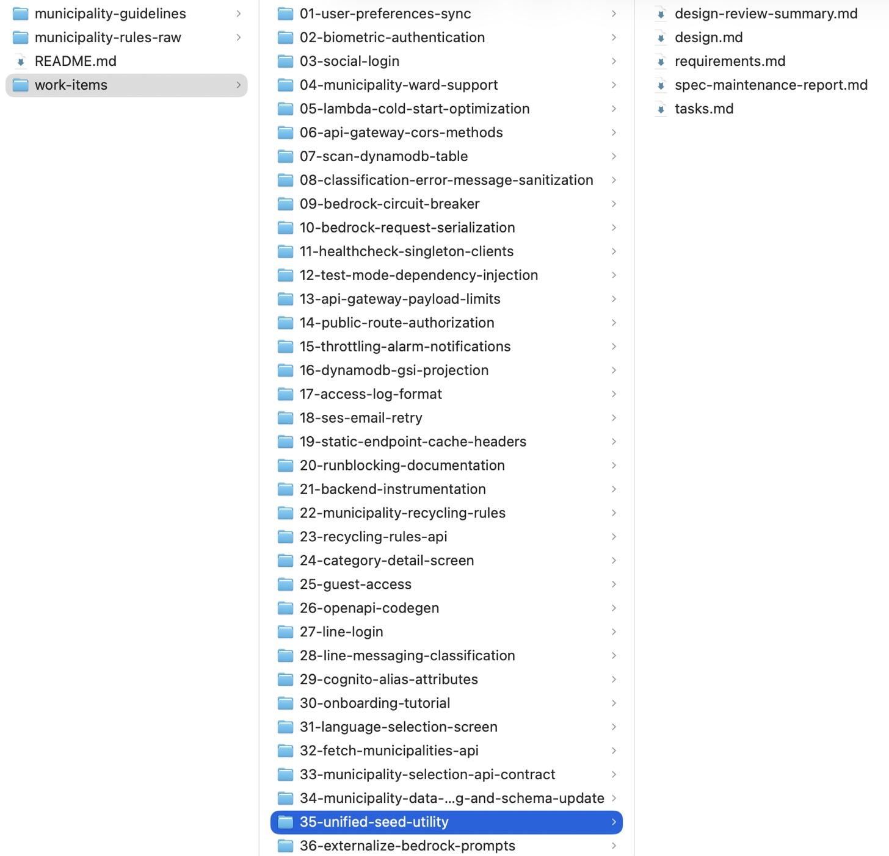

> Originally published on [Substack](https://georgeracu.substack.com/p/beyond-kiro-engineering-quality-gates) on 10 May 2026.

## The “Not Enough” Problem

After publishing my journey from [SDD sceptic](/blog/articles/why-i-think-that-sdd-is-not-waterfall/) to [Kiro practitioner](/blog/articles/kiro-spec-driven-workflow/), the most interesting feedback I received was about the artifacts created before writing code, not about the philosophy of thinking before building.

[Kiro Spec-Driven Workflow](/blog/articles/kiro-spec-driven-workflow/)

“Three documents aren’t enough,” several readers noted. “Requirements, Design, and Tasks cover the *what* and the *how*, but they don’t cover the *was it actually done right?*“

They were right as in my early days with Kiro, those three save games were a revolution. They stopped the “Wandering AI” from refactoring my entire CSS architecture when I only asked for a button. As [Gomi Bunrui](https://gomi-bunrui.app/) grew from a simple classifier to a production Progressive Web App with complex municipal rules and auth layers, the three-artifact model started to show its ceiling.

A plan is only as good as its verification. If you’re doing unsupervised or lightly supervised implementation with AI agents, you need a quality lab at the end of the conveyor belt. This is why I expanded my Spec-Driven Development workflow from three pillars to seven.

## The Three-Artifact Ceiling

Standard SDD (as implemented by tools like Kiro or spec-kit) usually produces:

1. **Requirements:** What do we want?

2. **Design:** How will we build it?

3. **Tasks:** What are the atomic steps?

This works beautifully for feature implementation where the “Happy Path” is well-understood. Production software is rarely that tidy, as it lives on error handling, security boundaries, regression testing, and long-term maintenance.

If an AI agent follows a design but misses a critical security check that wasn’t explicitly in the 30-line Design document, is that the agent’s fault or the process’s fault?

I realised that to truly trust an agent with my codebase, I needed to borrow a concept from the Toyota Production System: **The Andon Cord**.

## The Andon Cord for AI

In a Toyota factory, any worker on the line can pull a cord to stop production if they see a defect. (I dug into Jidoka and the Andon Cord in more depth in [an earlier post](/blog/articles/jidoka-for-ai-assisted-coding/), so I’ll keep this short.) This is seen as the only way to build quality *in* rather than inspecting it *out* at the end.

My expanded SDD workflow is essentially a series of seven “Quality Gates” that act as Andon Cords. If any gate fails, the pipeline stops, the implementation doesn’t happen, the merge doesn’t happen.

Here’s the 7-pillar architecture I built using portable Agent Skills.

### The Spec Generator: The Workhorse

This is the evolved version of the Kiro flow, and the output isn’t just “markdown”. Requirements follow EARS notation so they’re testable. The design step reads existing codebase patterns first to keep architectural consistency. Tasks land in 2-5 minute atomic units that assume the implementing agent has zero context.

### The Spec Design Review: Gate 1

Before a single line of code is written, a separate agent session loads the Requirements and the Design. Its only job is to find gaps. *Is every requirement covered? Does the API match our convention? Did we forget the municipal fallback logic?* This is the “Shift-Left” principle in action: finding the bug in a text file is 100x cheaper than finding it in a Lambda log.

### The Spec Task Review: Gate 2

This gate audits the task list, making sure “Finish branch” isn’t the only verification and that the mandatory ending tasks are present: E2E tests, documentation updates, and “Evidence Collection.” If the task list is just “write code,” this gate pulls the cord.

### The Spec QA Review: The Test Plan

This skill runs twice. In **Plan Mode**, it produces a five-layer test plan (Unit, Integration, E2E, Security, Performance) based on the requirements. In **Review Mode** (after implementation), it audits the *actual* tests written by the coding agent against that plan. If the plan called for an integration test for the 404 path and the agent skipped it, the pipeline blocks.

### The Spec Implementation Audit: Evidence

“Trust but verify” becomes literal here. After implementation, this skill verifies that the finished code actually matches the spec. As agents sometimes hallucinate about work they think they produced, this audit requires build output, test results, and file diffs to be pasted into the audit document.

### The Spec Maintenance: Living Docs

This is what prevents “Waterfall Fossilization.” When Spec 35 changes a data model defined in Spec 02, the maintenance skill finds Spec 02 and annotates it. My 67 specs are a queryable, semantic map of the current state of the system.

### The Spec Workflow: The Orchestrator

The brain that ties it all together. It defines the chaining rules: *After brainstorming, override the default plan-writing and trigger the Spec Generator. After implementation, block the branch-finish until the Audit and QA Review pass.*

## Inside the Quality Gates

To give you a sense of the “detail” people were asking for, here’s how one of these gates actually works.

### The EARS Guardrail

In the **Spec Generator** phase, I don’t just ask for “requirements.” I enforce **EARS (Easy Approach to Requirements Syntax)**. EARS is a family of five patterns, but two of them carry most of the weight:

> WHEN `<event>`, THE `<System>` SHALL `<behavior>`
>
> THE `<System>` SHALL `<behavior>`

The first is for event-driven behaviour, the second (the “ubiquitous” form) for invariants that always hold. Spec 34 leans heavily on the ubiquitous form, as it’s defining a data layer rather than user interactions.

**Example from Spec 34 (Municipality Data Seeding), §4.2 Bulk Seeding Script:**

- THE seeding script SHALL support idempotent UPSERT operations, overwriting existing records with the same PK/SK

By forcing this structure, the requirement becomes binary. It either passes or fails. There’s no room for the AI to assume that “idempotent” means “skip if the record exists” rather than “overwrite”. Either the second run produces the same final state as the first, or it doesn’t.

### The Design Review Prompt

The **Spec Design Review** spins up a specialised agent session with a strict persona. Here’s a snippet of the instruction I use:

> “You are the Lead Architect. Review the attached Requirements and Design. Your goal is to find architectural drift. Specifically:
>
> 1. Does every REQ-XX have a corresponding implementation detail in the Design?
>
> 2. Does this design introduce a new pattern that contradicts existing patterns in `src/shared/`?
>
> 3. Identify three ‘silent assumptions’ the author made that aren’t documented.  
>     **DO NOT suggest code changes. Only identify gaps in the markdown.**“

This “No Code” constraint is the secret sauce. By preventing the reviewer from writing code, I force it to stay in the architectural layer. If it finds a gap, it “pulls the Andon Cord,” and I fix the *text*, not the implementation.

### The Audit Trail

The **Implementation Audit** isn’t satisfied with “the agent says it’s done.” Lately I’ve started recording the git hash beside each task in the spec’s status summary table. The hash sits next to the task forever, so a year from now I can trace any line in the Design back to the commit that delivered it.

A snippet from Spec 34 (Municipality Data Seeding):

**TaskStatusNotes**1. Infrastructure (GSI)Done`6748559` — EntityTypeIndex GSI added to template.yaml2. Data ModelsDone`6748559` — City/Prefecture models updated3. Repository UpdateDone`6748559` — GSI queries and batchWriteItems implemented

This is what “Living Docs” actually looks like. The spec doesn’t get stale, it’s a permanent log of what was promised, what was done, and where the proof lives.

When one spec changes parts of another, the **Spec Maintenance** skill writes the impact report so future-me doesn’t have to do archaeology:

The hash is captured at the moment of commit, not later. After every task lands, one line (`git log -1 --format=%h`) pulls the short hash, and the subagent writes it into the row it just ticked. Reconstructing that link weeks later, after squashes and rebases and the occasional branch rewrite, is often impossible. So the rule is: cheap now, free forever.

Four skills share custody of the trail. The **Spec Generator** creates the table when `tasks.md` is written, with every Notes cell empty. **Subagent-Driven Development** fills each cell in as the work happens. **Implementation Audit** reads the table at the end and refuses to pass the spec if any code-producing task is missing a hash, or if any listed hash doesn’t resolve. **Spec Maintenance** reads the table months later, when a future spec supersedes part of an old one, and cites the exact commit in the older spec’s annotation: *(superseded by work-item 36, commit 6748559)*.

A few invariants I lean on:

- **Hashes are short, not full SHAs.** Six characters.

- **Multi-commit tasks list every hash.** A “single task” that shipped as refactor + fix-up + tests gets all three, comma-separated. A lone checkmark would have hidden the shape of the work.

- **Missing hash is MAJOR. Unresolvable hash is CRITICAL.** A fabricated or stale hash is worse than no hash at all.

In practice this gives me two arrows. From any line of code, I can walk back to the requirement that justified it. From any requirement, I can walk forward to the commit that delivered it. When a bug eventually surfaces in something I half-remember writing, I won’t be grepping commit messages or guessing from dates. I’ll open the spec, find the task, and run `git show <hash>`.

## Composing Quality

The magic is in the **composition** of skills. I reuse general-purpose “superpowers” (like Brainstorming or Subagent-Driven Development) and wrap them in these SDD-specific quality gates.

(See the diagram in [SDD Is Not Waterfall](/blog/articles/why-i-think-that-sdd-is-not-waterfall/) for the full visual breakdown).

When people say “3 artifacts aren’t enough,” they’re usually looking for the **feedback loop**. By adding these extra four pillars (Review, QA, Audit, and Maintenance), you turn a linear document-writing exercise into a circular engineering process.

## The Result: 67 Save Games

Using this expanded flow, Gomi Bunrui reached 67 specs. The later specs (from 31 onwards) were significantly more complex than the early ones. They involved extracting shared logic into modules, migrating from hardcoded prompts to Bedrock config files, and adding multi-municipality support.

Because each of these changes went through the 7-gate pipeline, I could walk away from the project for two weeks and come back with total confidence. I didn’t need to read the code to remember how the GSI seeding flow worked; I read the Spec 34 Design Review and the QA Audit.

The dopamine still comes late. You still have to spend an hour thinking and reviewing before you see a single green checkmark in your terminal. When that checkmark finally appears, though, it’s backed by a multi-layered verification system that no manual “test-first” approach can match for speed and rigour.

## What’s Your Cord?

If you’re finding that AI agents are still “wandering” or that your documentation is falling out of sync with your code, don’t give up on SDD. Just expand your definition of what a “Spec” is.

A spec isn’t a document. Think of it as a lab, a series of gates, the Andon Cord that lets you stop the line before a bug ever makes it to a pull request.

In the next post, I’ll dig into the specific prompts and instructions inside these skills so you can build your own Quality Lab.

*P.S. If anyone at Kiro happens to be reading: thanks for the reshares on the last post. Free credits going spare would happily go toward Spec 70.*

------------------------------------------------------------------------

## Glossary

**Andon Cord**: A Toyota Production System concept where any worker can stop the line to address a defect. In this workflow, Quality Gates act as Andon Cords for AI agents.

**Quality Gate**: An automated or semi-automated checkpoint in the development lifecycle that validates the output of a previous stage against predefined standards.

**EARS (Easy Approach to Requirements Syntax)**: A pattern set for writing testable requirements (e.g., `WHEN <event>, THE <System> SHALL <behavior>`). Used in Kiro spec generation.

**Shift-Left**: The practice of moving testing and quality verification to the earliest possible stage in the development process.

------------------------------------------------------------------------

## References

1. [SDD Is Not Waterfall](/blog/articles/why-i-think-that-sdd-is-not-waterfall/)

2. [Kiro’s Spec-Driven Workflow](/blog/articles/kiro-spec-driven-workflow/)

3. [The Toyota Way](https://www.toyota-europe.com/world-of-toyota/feel-toyota/toyota-production-system) - Reference for Andon and Jidoka principles.

4. [AgentSkills Specification](https://agentskills.io/specification)

5. [EARS Notation (Kiro docs)](https://kiro.dev/docs/specs/feature-specs/#requirements-with-ears-notation)

6. [The Jidoka Principle: Strategic Quality Control in AI-Assisted Development](/blog/articles/jidoka-for-ai-assisted-coding/)

------------------------------------------------------------------------

*Part of the Gomi Bunrui series.*  
*Follow: [Substack](https://georgeracu.substack.com/) · [LinkedIn](https://www.linkedin.com/in/george-racu-70670443)*
