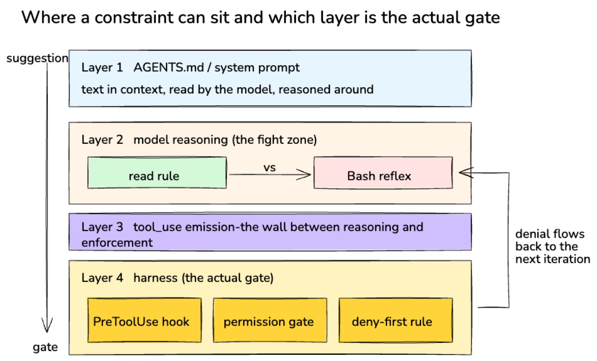
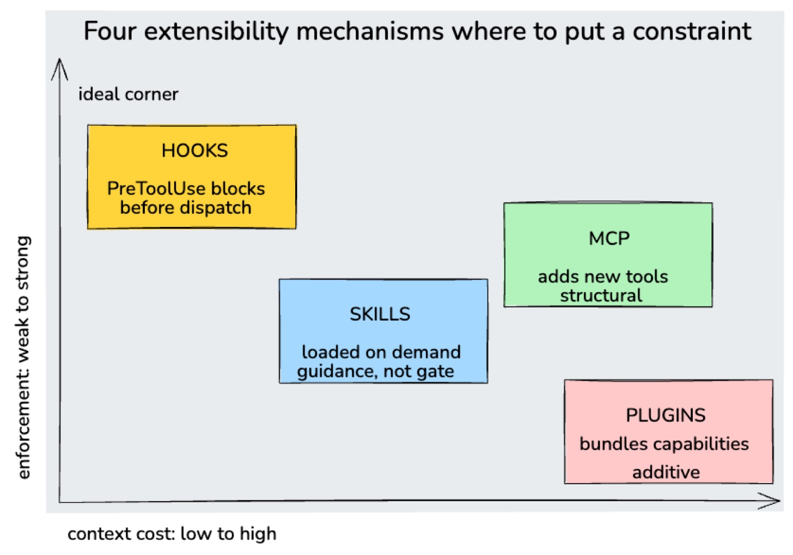

> Originally published on [Substack](https://georgeracu.substack.com/p/why-my-agentsmd-lost-to-a-bash-reflex) on 30 May 2026.

# Why My AGENTS.md Lost to a Bash Reflex

Last week I wrote about an agent that read my AGENTS.md, acknowledged the rule, and ignored it anyway. The agent’s own words were that there was no justification for the slip and it should have used the obsidian CLI. I took that admission at face value at the time, framed it as a confession, and moved on. Reading the paper that the post leaned on, I now think the agent couldn’t articulate the real justification, as it would have been telling me that the architecture wasn’t designed for the rule to win in the first place.

The paper is *Dive into Claude Code: The Design Space of Today’s and Future AI Agent Systems* \[1\], an architectural walk-through of the system written by analysing the TypeScript source. The bit that mattered for last week’s post was the 1.6% figure: about that much of the codebase is AI decision logic, and the rest is operational machinery around it. Well done to the team at Anthropic’s. The paper treats that ratio as evidence of a deliberate bet, and the bet has a name.

### Where Reasoning Lives, And Where It Doesn’t

The paper organises its analysis around four design questions, and the first one is “where does reasoning live?” In Claude Code, the model reasons about what to do, and the harness is responsible for executing actions. The model emits structured `tool_use` blocks, and the harness parses them, checks permissions, dispatches the call, and collects the result. The model never directly touches the filesystem or runs a shell command.

There’s a sentence in §3 that I had to re-read a few times:

> Because reasoning and enforcement occupy separate code paths, a compromised or adversarially manipulated model cannot override the sandboxing, permission checks, or deny-first rules implemented in the harness.

The whole architecture is built around the assumption that the model cannot be trusted with constraint enforcement, as the model is both the thing being constrained and the thing reading the constraint. Let me say that again: **the thing being constrained and the thing reading the constraint**. Anything that lives on the reasoning side of that split, whether it’s a system prompt, an instructions file, or a polite reminder in the conversation, can be reasoned around. Anything that lives on the harness side is the gate the model can’t unlock.

**AGENTS.md lives on the reasoning side**; so does my “use the obsidian CLI” rule and so does the Bash reflex the model picked up from billions of tokens of training data. Three reasoning-side signals, all jostling for influence on the next tool call, and the one that’s been reinforced ten million times (or something like that) during pre-training is going to win the tie (at least in my sessions).

### Two Principles Doing The Heavy Lifting

The paper formalises this in its design-principles table, and two of the thirteen principles named there map directly onto what I was watching happen in my sessions.

The first is **values over rules**. The paper describes it as a choice between “rigid decision procedures” and “contextual judgment backed by deterministic guardrails”. Claude Code picks the second. The model is given a value-shaped instruction (be careful with file edits, prefer reversible actions) and a guardrail that doesn’t depend on the model’s good behaviour (a deny-first permission gate). The model gets to use judgment within the guardrail, as the guardrail handles what the judgment would have got wrong.

AGENTS.md, as I wrote it, was a rigid rule pretending to be a value. “Use only the obsidian CLI for vault interactions” is the kind of rule that needs a deterministic guardrail behind it, as no amount of contextual judgment is going to overcome a strong default. I gave the model the rule and not the guardrail, and the architecture’s whole position is that this combination doesn’t work. I wonder how many of you think that rules in AGENTS.md are being followed all the time.

The second principle is **minimal scaffolding, maximal operational harness**. The paper contrasts Claude Code with systems like Devin and LangGraph, which invest in scaffolding (explicit planning structures, state graphs) to shape what the model does. Claude Code’s bet is the opposite, as it invests in the harness around the model rather than the scaffolding inside it. The 1.6%/98.4% ratio is the evidence: almost none of the code is trying to make the model behave a particular way, and almost all of it is making sure the things it does can be inspected, blocked, or rolled back.

AGENTS.md is scaffolding, an attempt to shape the model’s choices before the choice is made. The architecture I was using is built on the premise that this is the wrong place to invest.

### What This Means For My Vault

There’s a practical answer hiding inside this, and as I learned, it isn’t “write a better AGENTS.md”. The paper points at four extensibility mechanisms (MCP, plugins, skills, and hooks) and notes that they sit at different “context costs”. Hooks are the one that matters for my problem, as `PreToolUse` hooks fire before a tool call leaves the harness, with full information about what’s about to happen, and they can block it. That’s an actual gate, not a description of one.

If I want the obsidian CLI rule respected, the real fix is a `PreToolUse` hook that inspects every Bash call about to fire against the vault directory and denies it with a message that points the model at the obsidian CLI instead. The denial flows back into the next loop iteration (the Andon Cord 2.0 behaviour I’ve been writing about), and the model adapts. The rule lives where rules actually work, as the harness doesn’t argue with itself.

I haven’t wired the hook yet and I’ve been writing about it for two weeks instead, which is its own commentary on practitioner discipline. The Bash reflex got me again, in a different shape.

### What AGENTS.md Is Still Good For

I won’t pretend AGENTS.md is useless, as it does prime the model toward a posture, and that posture shows up in tone, in vocabulary, in the kinds of suggestions the model volunteers when it isn’t being constrained. The difference between a model that knows the vault is an Obsidian vault and one that doesn’t is worth something.

The thing AGENTS.md can’t be is the gate. The paper is explicit about which mechanism is the gate, and that mechanism is not the document at the top of context. The next thing on my list is wiring one rule, just the obsidian CLI one, as a `PreToolUse` hook this week, and watching whether the reflex still wins. If you’ve got an AGENTS.md doing duty as enforcement, pick the rule that hurts most when it’s ignored, and try the same.

------------------------------------------------------------------------

## Glossary

- **Harness**: the surrounding system that calls the model, parses its tool requests, checks permissions, dispatches the action, and feeds the result back.

- `tool_use` **block**: the structured message format the model emits to request an action (a file read, a Bash call, a tool invocation), parsed by the harness.

- **PreToolUse hook**: a user-defined check that fires before a tool call is executed; it can allow, modify, or deny the call with a message.

- **Deny-first**: a permission posture where unrecognised actions are blocked by default and escalated to the user rather than allowed silently.

## References

1. Liu, J., Zhao, X., Shang, X., & Shen, Z. (2026). *[Dive into Claude Code: The Design Space of Today’s and Future AI Agent Systems.](https://arxiv.org/html/2604.14228v1)* [arXiv:2604.14228v1](https://arxiv.org/html/2604.14228v1).
