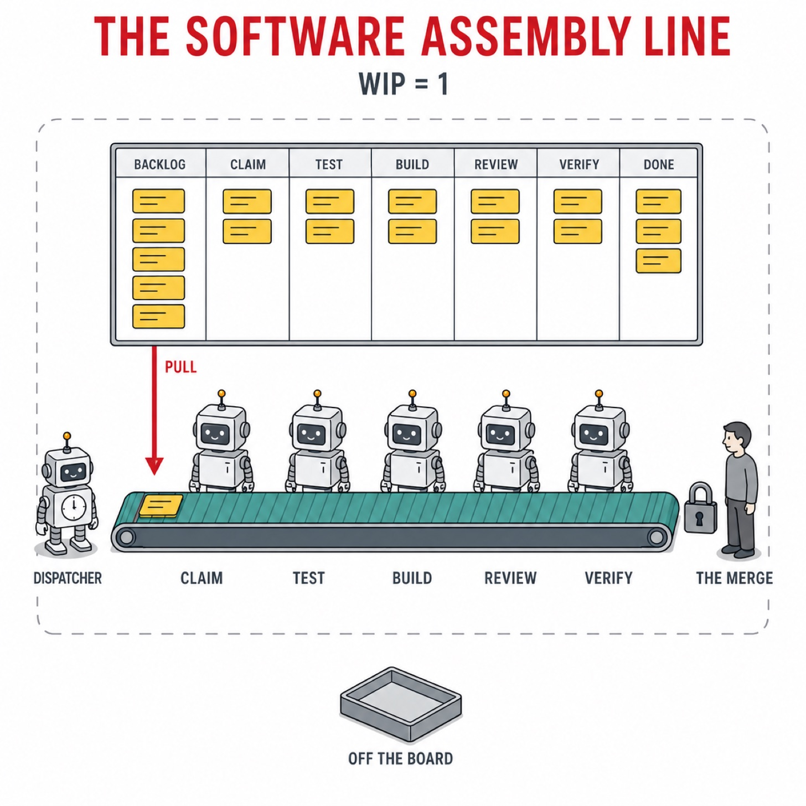
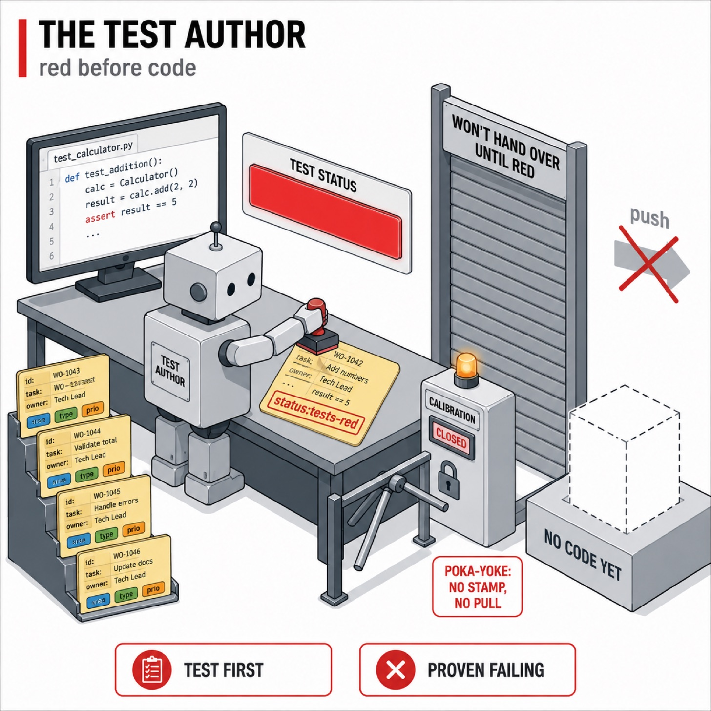
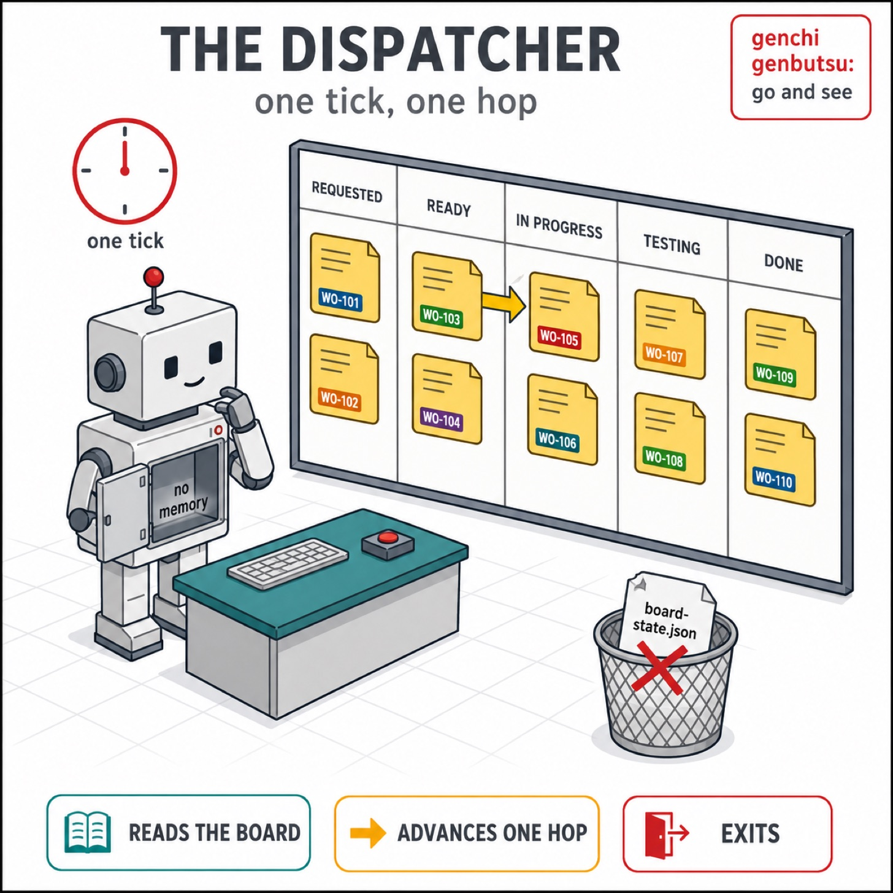
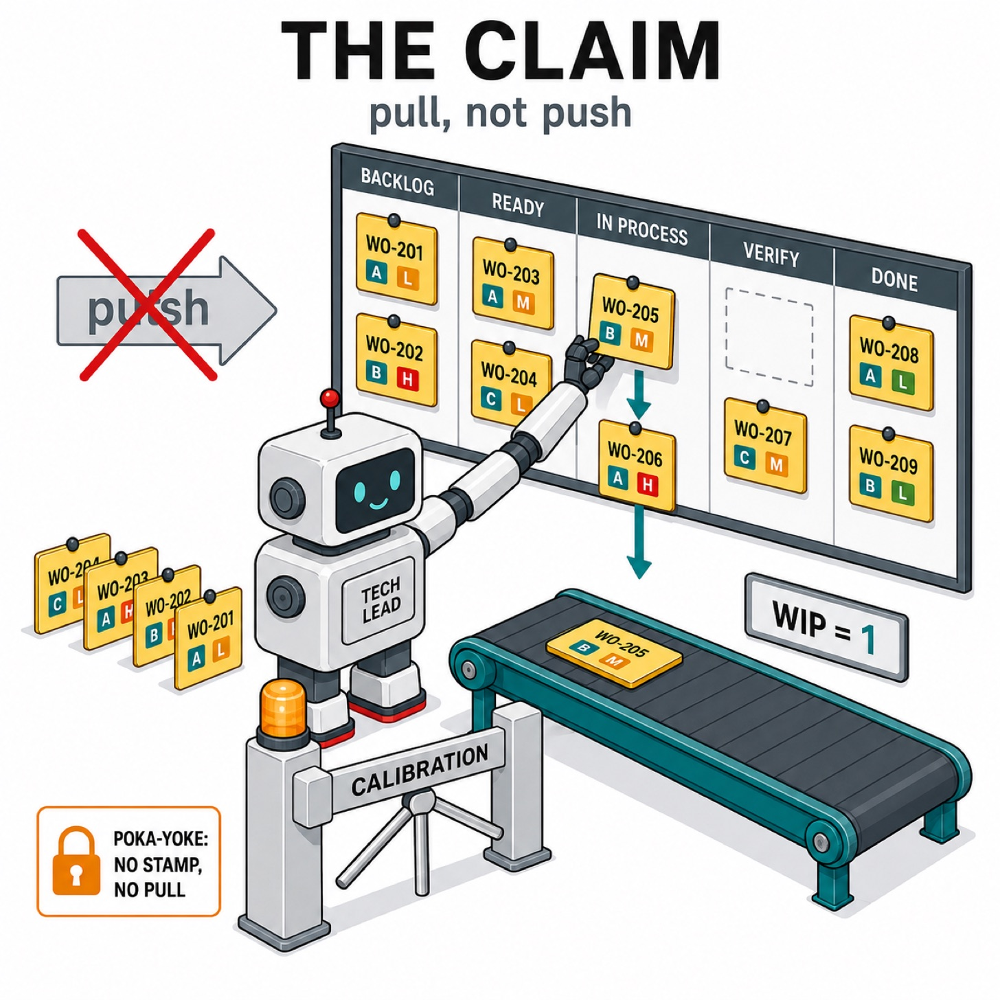
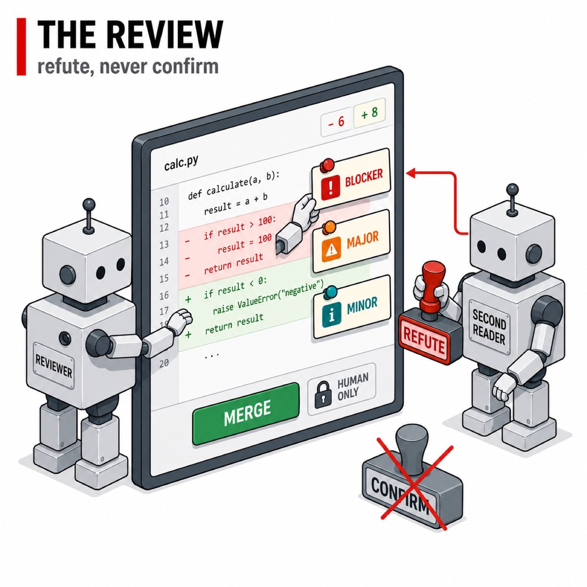
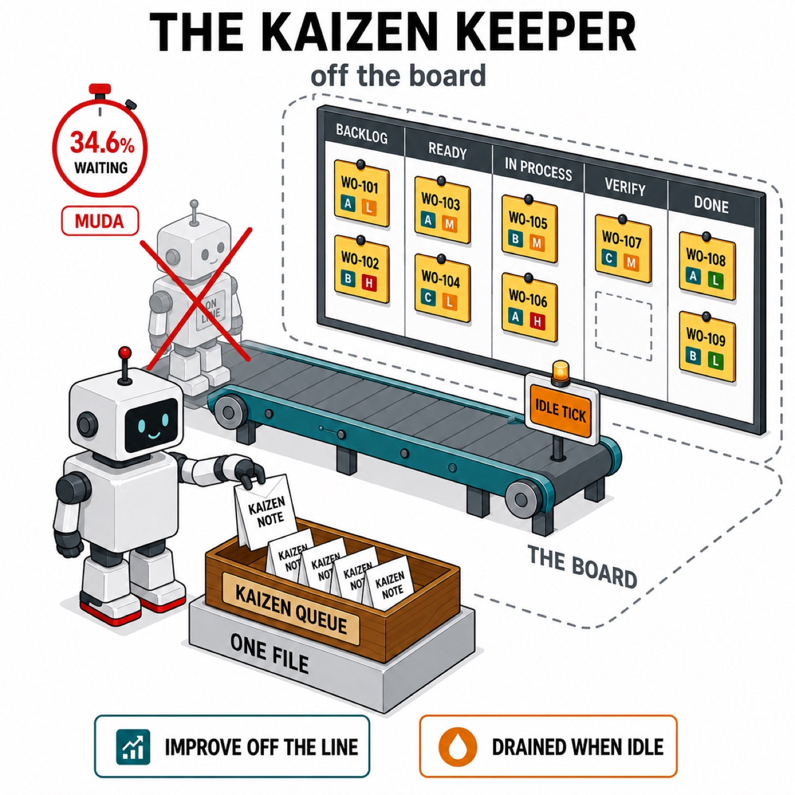

> Originally published on [Substack](https://georgeracu.substack.com/p/seven-github-labels-run-my-entire) on 8 August 2026.

*One card on the belt, five stations, one board above it.*

The first version of my agent pipeline had a file called `board-state.json`. That JSON mapped each GitHub issue to the branch an agent had cut for it and the pull request that would eventually close it, and it looked necessary, as agents handing work to each other have to agree on which branch belongs to which issue. I deleted the file and it turned out to be a good decision. The filename still sits in the repo’s `.gitignore`, so I clearly have some cleanup to do.

## The Line: Five Stations and a Poller That Decides Nothing

My line is built on [Flue](https://flueframework.com/docs), a TypeScript agent framework, and it drives the GitHub board of one of my own side projects, a private repo with real issues on it rather than a sandbox.

Five stations hold the line itself, and only one slice sits on them at a time: a tech lead pulls a slice into flight, a test author proves the acceptance tests red before any code exists, an engineer runs red, green, refactor until they pass, a reviewer posts severity-gated findings and spawns a second reader that may refute one but never confirm it, and a verifier makes the merge call. Around them sit the stations that run without holding the line up: a shaper cutting an epic into shippable slices, an estimator sizing them, an author writing the feature-level acceptance journey, a triage station turning a raw issue into acceptance criteria, a calibration check, an epic closeout and a kaizen keeper. I do the merging, as nothing in the line is allowed to land its own work. I call the whole thing my *Software Assembly Line*, and most of its shape is borrowed from the Toyota Production System: standard work at every station, one piece flowing at a time, and a person rather than a machine making the call at the end.

*The test goes red before any code exists.*

Driving all of it is a dispatcher, which is a poller and nothing more. One tick reads the board, works out which station each issue is waiting on, advances what it finds by a single hop, and exits. No daemon, no in-memory anything, and by design no judgement: it decides nothing a model could decide, so every choice is a label lookup rather than a prompt. Genchi Genbutsu is the TPS habit of going to see the actual thing rather than trusting a report about it, and a poller that re-reads the live board on every tick is about as literal a translation of that as software gets.

*One tick, one hop, and no memory of its own.*

## The Second Board: Two Records, One Always Wrong

My ledger file failed for the reason those files usually fail. As best I remember it, an agent died partway through claiming a slice, so the JSON said one thing and GitHub said another, and I had no real way to decide which was right; then I relabelled an issue by hand to unstick myself, which the file knew nothing about, and the drift widened. I call it the *second board*: the moment a pipeline writes down what it’s doing, it owns two records of the same truth, and one of them is always slightly wrong.

Kanban has an opinion about this, and it’s why the physical version works at all. The card on the wall is the state, and there’s no second wall.

## How I Replaced It: Changing the Model From My Phone

So what did that file actually know that GitHub didn’t? Everything the ledger held is now either a naming convention or a label.

A slice’s branch is `issue/<N>-<slug>`, so any station that needs it matches on that prefix rather than looking it up, and the pull request comes back the same way. Each slice gets its own git worktree, and its path is a pure function of the issue number, so three different workflows derive the same directory independently without anyone storing it. The comment I left in that file is the whole philosophy in one line: derived by convention and never stored.

Position on the line is a label. A slice carries exactly one of `status:todo`, `status:blocked`, `status:in-progress`, `status:tests-red`, `status:in-review`, `status:andon` or `status:done`, and the dispatcher advances purely by reading it, so the label *is* the position. Nothing is ever pushed onto a station either, as each tick pulls whatever the board says is ready, which is the one piece of TPS that came across into software needing no translation at all. Human signals are labels too: `andon:cleared` says I’ve looked at a stop and cleared it, and `andon:override` forces a restart past the recurrence cap when I’ve decided I know better.

*No calibration stamp, no pull.*

The part that surprised me is how far this stretched. Every slice carries a t-shirt size as a `size:*` label, and that label routes the four heavy stations to a model tier. Sizing was the shaper’s job until it turned out to be guessing on the one field whose whole purpose is predicting model fit, so a separate estimator now scores each slice against five lenses and the workflow maps those scores to a size: the agent scores, the code decides. Only the smallest rung stays local now, as one slice a notch above it burned the local coder’s entire thirty-minute cap twice over, and the largest rung means re-cutting the work rather than reaching for a bigger model. So whether a piece of work runs on my own hardware or costs me real money is readable on the card, and I can change my mind by editing a label on my phone. Oh, I didn’t mention that this assembly line works with local models, I’ll do it in a future post.

Labels stretched again when the line grew an outer loop. A feature arrives as an epic, gets cut into slices, and has its own end-to-end acceptance journey written and proven red before any slice is pulled; when the last one lands, that journey runs against the assembled branch and decides whether the feature integrates. That needed somewhere to live, and it went where everything else went, three more labels kept off the WIP count so an epic can sit in progress beside the one slice actually on the line.

## Ctrl-C With No Repair Step

Two things, and I use both constantly.

I kill the dispatcher mid-tick without ceremony. Ctrl-C during a station, restart, and the next tick picks up where the labels say the work is. There’s no repair step, as there’s nothing to repair.

I overrule the line by hand. Dragging a card back a station on GitHub is a legitimate operation rather than a corruption, and the dispatcher agrees with me on the next tick. Kanban again: pull from the visible board, and let a human move a card when they see something the line can’t.

*The second reader can refute a finding, never confirm one.*

## The Second Board I Kept Anyway

The clean version of this story ends there, and the real one doesn’t.

A gitignored `.metrics/` directory sits beside all of this. The directory began as a lock. Enforcing a WIP limit of one means reading the board and then acting on it, which is a race the first cron schedule found immediately. The lock has company now. An append-only event log is where lead times and model spend per slice come from. Alongside it sits `calibration.json`, a stamp recording whether the project’s own check commands actually answer the question they claim to: whether the test command terminates rather than sitting in watch mode, whether its exit code tells the truth. A missing or stale stamp refuses the pull, so that one file can genuinely stop the line, which makes it the only poka-yoke I’ve built: the line can’t start work it has no way of checking. Half a dozen more sit beside them, mostly reports.

The one that gives me pause is the kaizen queue. Kaizen used to run inside the tick, where waiting for it ate 34.6% of all station capacity with a slice sitting behind it, and detaching the process wasn’t available either, as two large local models must never be resident at once and the serial tick is what enforces that. An improvement practice generating textbook muda, the waste of waiting, is not lost on me. So a kaizen request is now written to a file and drained on a tick that moved nothing, of which there are plenty. That works, I like it, and it’s still a queue of pending work the board knows nothing about.

*The one queue the board can't see.*

Which makes the honest version of my rule narrower than the title claims. Nothing off the board is authoritative about *where a slice is*, and that has held: delete `.metrics/` and the line resumes correctly on the next tick, minus its history, its queued improvements and its gauge, and it has to re-prove that last one before it pulls again. Position lives on the card, and intent, it turns out, doesn’t entirely.

I’m less sure about those two files than I sound. The event log is the one thing in there I can’t reconstruct, and I’ve caught myself wanting to query it mid-run, while the kaizen queue is a pile of work waiting to happen that only one file knows about. Both are more or less how the first ledger started. If your agents coordinate through a file of their own, try deleting it and see how much the board can already tell you, and I’d be curious how much turns out to be convention you hadn’t named yet.

## Glossary

- **Flue**: a TypeScript agent framework with its own workflow, session and sandbox primitives. The runtime this line is built on.

- **Dispatcher tick**: one pass of the poller. Reads the board, advances each slice by at most one station, exits.

- **Slice**: one thin vertical piece of work, filed as a GitHub issue, which is also its kanban card.

- **Epic**: a whole feature, filed as its own issue and cut into slices. It carries its own acceptance journey and its own labels, and runs beside the line rather than on it.

- **WIP limit**: work in progress limit. Mine is one slice across the whole line, including stopped ones.

- **Andon**: the Toyota Production System practice of stopping the line on a defect and pulling a human in. Here it’s a label plus a root cause comment on the card.

- **Kaizen**: the TPS practice of continuous small improvement. Here it’s a station that proposes one change per slice, off the line and queued rather than routed by a label.

- **Genchi genbutsu**: the TPS habit of going to see the actual thing rather than trusting a report about it. Here it’s the dispatcher re-reading the live board on every tick.

- **Poka-yoke**: a device that makes the wrong action impossible rather than merely discouraged. Here it’s the calibration stamp refusing the pull.

- **Muda**: waste, in the TPS sense. Waiting is one of its classic forms, and the one my own line kept producing.

- **Worktree**: a second working directory attached to one git clone, checked out on its own branch, so each slice gets an isolated tree.

- **Toyota Production System**: a production system based on the philosophy of achieving the complete elimination of waste in pursuit of the most efficient methods

## References

1. [Flue](https://flueframework.com/docs)

2. [Toyota Production System](https://global.toyota/en/company/vision-and-philosophy/production-system/)
