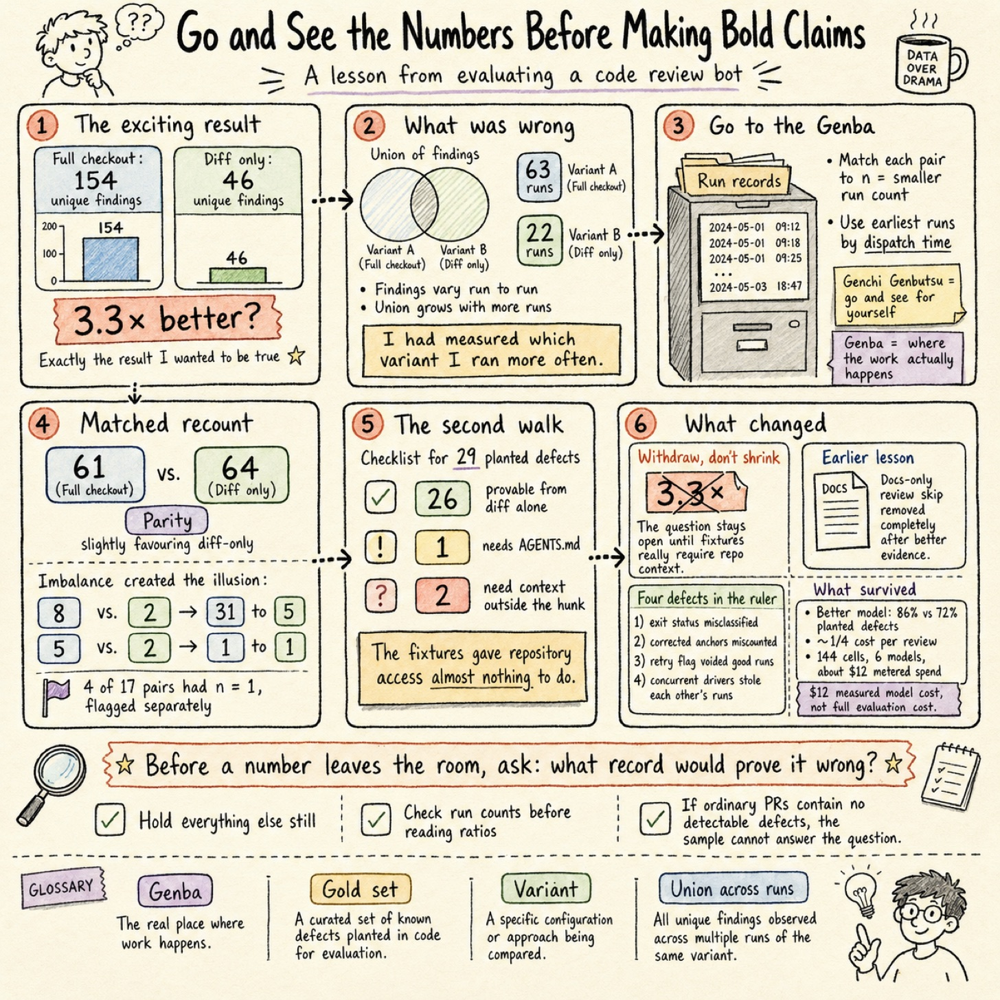
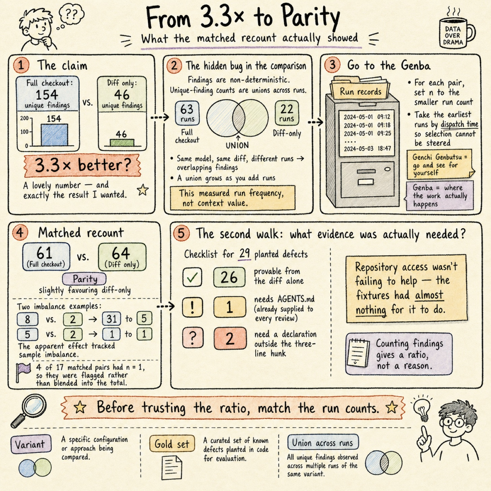
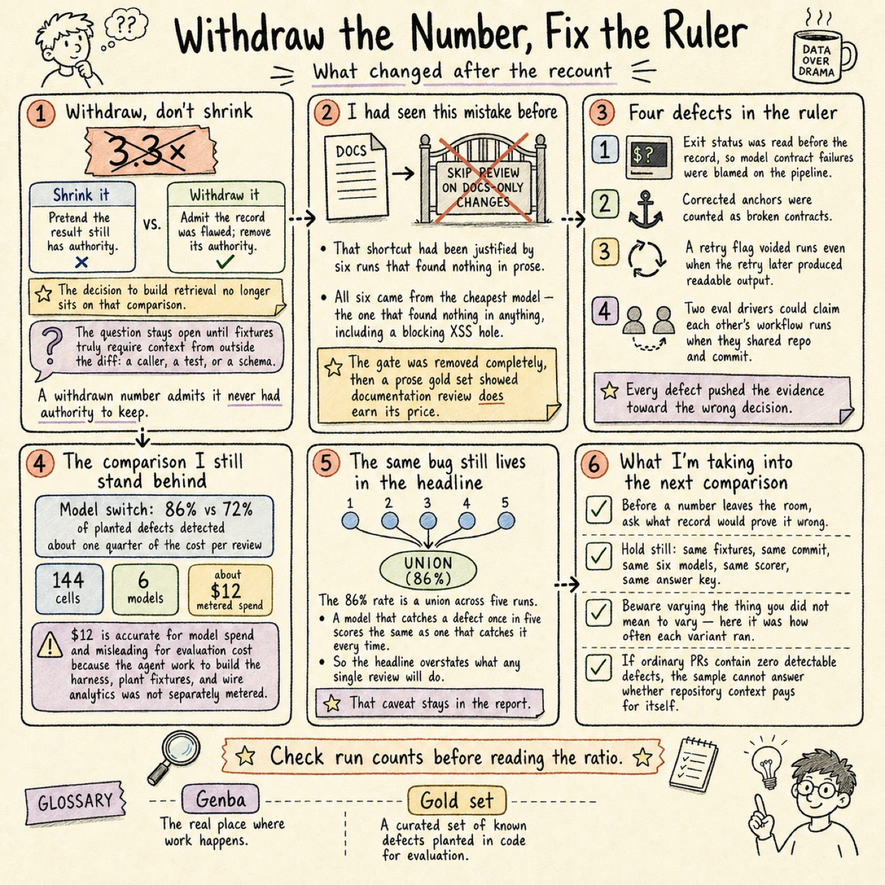

> Originally published on [Substack](https://georgeracu.substack.com/p/go-and-see-the-numbers-before-making) on 14 August 2026.

In July I measured whether a code review bot does better work with the whole repository in front of it than with just the diff. The comparison came back 154 findings unique to the full checkout against 46 unique to diff-only, which is better than three to one in favour of handing it everything.

I’d been wanting to build a retrieval layer for weeks. Here, at last, was my evidence.

## The Result I Wanted to Be True

That’s the part worth admitting first, as the number landed pointing exactly where I already wanted to go. The retrieval layer is the interesting engineering in that project, the thing I’d been sketching in the backlog under a note about change impact, and 3.3× is a lovely multiple. In hindsight, a bit too lovely: big enough to justify the build, small enough that nobody squints at it.

The run itself wasn’t sloppy either. Twelve pairs drawn from 224 records in the analytics store, every model running both variants against the same frozen fixtures at the same commit, the arithmetic checked twice. So what was actually wrong with it?

Findings aren’t deterministic per run. Ask the same model to review the same diff five times and you get five overlapping, non-identical sets, so any count of unique findings is a union across runs, and a union grows with the number of runs you feed it. My variants had been sampled 63 runs against 22. Inside individual pairs the ratio ran five to one routinely.

I hadn’t measured whether repository access helps. I’d measured which variant I’d run more often.

## The Genba: A Folder Full of Run Records

Toyota has a phrase for this, *Genchi Genbutsu*, which translates roughly as “go and see for yourself”. You don’t reason about the work from a meeting room, you walk to the *Genba*, the place where the work actually happens, and look at it. For a model comparison the Genba is the run record, and every run I’d ever dispatched was still sitting in the store with its timestamps intact.

So I matched every pair to n equal to whichever variant had fewer runs, took the earliest runs by dispatch time so I couldn’t steer the selection (accidentally being the flavour I’d have been guilty of), and counted again.

## Sixty-One to Sixty-Four

Parity. Marginally favouring the variant with no repository access at all.

The original error shows its shape once you sort the pairs by how lopsided their sampling was. The most unbalanced pair, eight runs against two, produced the most unbalanced split at 31 findings to 5. The most balanced, five against two, produced 1 to 1. What I’d read as an effect was a picture of my own dispatch history.

Four of the 17 matched pairs land at n=1, where a single disagreement can’t be told apart from run-to-run variance. Those rows are flagged in the report rather than folded into the total, as averaging them away would have been the same mistake in a smaller font.

## The Second Walk: What Would You Have to Read?

Parity is a suspicious sort of result, so I went at it from the other direction. Rather than counting what each variant found, I annotated all 29 planted defects with the smallest piece of evidence that establishes them. What would somebody actually have to read to know this is a defect?

Twenty-six of the 29 are provable from the diff alone. Of the three that aren’t, one needs only AGENTS.md, which every review gets handed for free anyway, and the other two need a declaration sitting outside a three-line hunk of context.

That explains the parity, and the first read could never have got there, as counting findings gives you a ratio and not a reason. Repository access wasn’t failing to help. My fixtures had never given it anything to do. I’d built an instrument that couldn’t see the capability I was proposing to spend a month building, then asked that instrument whether the capability was worth building.

## Withdrawing a Number, Not Shrinking It

The comfortable move here is to soften the claim: the advantage is real but smaller, put 1.5× where 3.3× used to be, carry on with the retrieval layer on a humbler slide. Nobody reading the second version would think to check the first.

I took the number out and moved the decision instead. The gate on building retrieval doesn’t sit on that comparison any more, as it now sits on whether I can build fixtures whose proof genuinely lives somewhere a diff can’t reach: in a caller, a test, a schema. Until those exist the question is open rather than answered, and I don’t know whether repository context earns its cost.

Withdrawing rather than shrinking is the distinction, and it carries the whole thing. A shrunk number keeps the authority of the original while quietly changing its value. A withdrawn one admits it never had any authority to keep.

This same project had taught me the lesson once already, and I’d only half learned it. Early on I shipped a cost optimisation that skipped review entirely on documentation-only changes, and the evidence was six runs finding nothing in prose. All six came from the cheapest model in the field, which found nothing in anything, a blocking cross-site scripting hole included. The gate came out completely rather than getting narrowed, and a gold set built for prose then showed that reviewing documentation earns its price at these rates.

## Four Defects in the Ruler

None of the headline numbers were valid until four defects in the harness itself got found and fixed, and every one of them pushed the evidence towards a wrong decision.

The cell classifier read the driver’s exit status before consulting the record, so a model’s own failure to honour the output contract got filed as my pipeline’s fault, which flattered the worst offenders. Corrected anchors counted as broken contracts, quietly voiding about one healthy run in six. A retry flag fired whenever the first pass produced no readable output, including the many times the retry then delivered perfectly well, voiding 16 runs holding roughly 9% of all detection evidence, concentrated in exactly the models that need a nudge. And two eval drivers running at once claimed each other’s workflow runs, as resolution matched on a repository and commit that every cell of a set shares.

That last one still bothers me. A harness whose correctness depends on nobody running two of it is a harness that will eventually be run twice.

## The Same Bug, Still in My Headline

The comparison that survived all this was a model switch: 86% of planted defects detected against the incumbent’s 72%, at roughly a quarter of the cost per review, across 144 cells and six models for about twelve dollars of metered spend. I shipped it, and I stand behind it.

Twelve dollars is an accurate figure for what the models cost and a misleading one for what the exercise cost. The agent tokens spent building the harness, planting the fixtures and wiring up the analytics store ran well past it, and nothing meters that separately (maybe I should). The models are the cheap part of a model comparison, which is worth knowing before you plan one.

That detection rate is a union across five runs. A model finding a defect once in five scores identically to one finding it every time, and I’ve seen two separate models swing between 7 out of 8 and 8 out of 8 on the same fixture at the same commit. So the headline overstates what any single review will do for you, which is precisely the defect I’ve spent this post catching in the context variant, still sitting in the number I kept.

That caveat went into the report rather than getting quietly tidied out of the presentation.

## What I’m Taking Into the Next Comparison

One habit: before a number leaves the room, ask what record would prove it wrong. Time saved has no such record, which is why everyone reaches for it. A union of findings across unequal samples has one, and reading it took me an afternoon.

The held-still list matters as much as the result. Same fixtures, same commit, same six models, same scorer, same answer key, and the only thing I meant to vary was repository access. The thing I varied without meaning to was how often each variant ran, and that turned out to be the whole finding.

The question I still can’t answer is whether repository context ever pays for itself, as I haven’t found a population where the question is even askable. Twenty runs across five ordinary pull requests, both variants, two repeats each, about a dollar of model spend, came back with zero findings on all twenty. Not a pipeline failure but a sample failure, as those changes had been written and reviewed carefully enough to carry no defect either variant could find.

If you’re comparing two configurations of anything by counting unique findings across runs, go and check your run counts per variant before you read the ratio. I’d like to know whether yours were matched, or whether you’ve been reading your dispatch history too.

## Glossary

**Genba**: the actual place where work happens. In manufacturing it’s the shop floor; for a model comparison it’s the run record.

**Genchi genbutsu**: “go and see for yourself”. Forming judgements by observing the real thing rather than reasoning from reports.

**Gold set**: a purpose-built pull request with defects deliberately planted in it, used to measure what a reviewer catches.

**Variant**: one configuration in a comparison. Here one variant gave the reviewer a full checkout and the other gave it only the diff.

**Union across runs**: counting a defect as found if any run found it. Grows with the number of runs included, which is why variants have to be matched before the counts get compared.

## References

1. [Pi-Agent vs Claude Code in Custom Code Review Agents](/blog/articles/pi-agent-vs-claude-code-in-custom-code-review-agents/) (the harness comparison this project grew out of)
