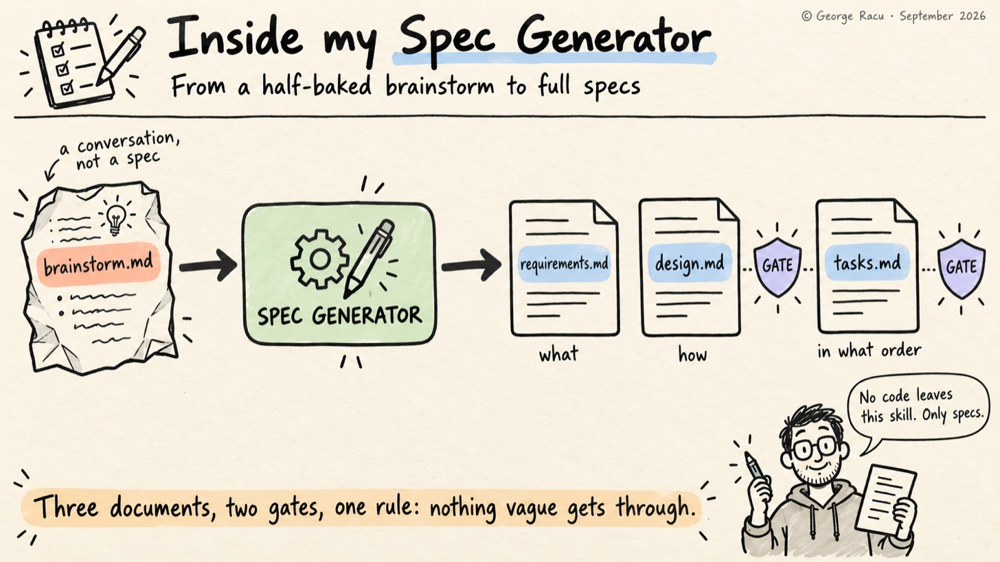
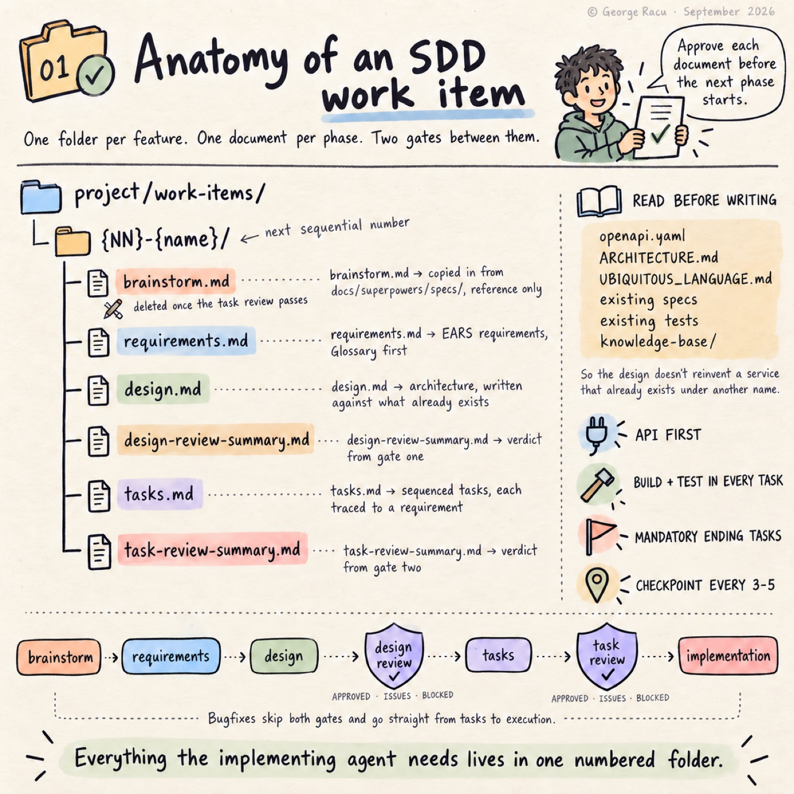
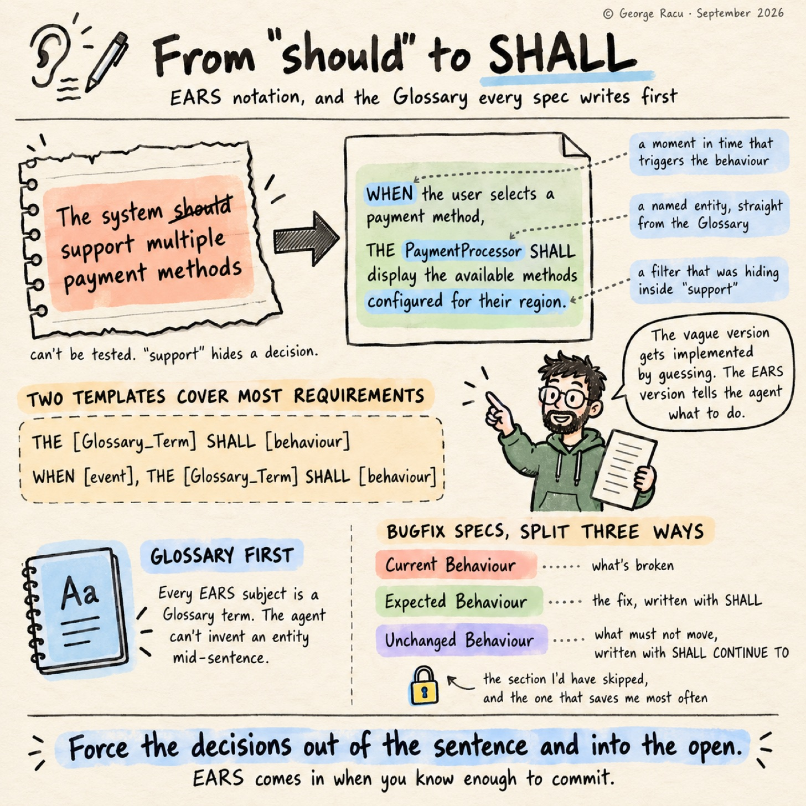

> Originally published on [Substack](https://georgeracu.substack.com/p/inside-my-spec-generator-from-a-half) on 7 September 2026.

While working more and more with semi-autonomous agents, I found that without the right guard-rails in place, I would get back grammatically perfect aspiration: “should support”, “may include”, “as appropriate”. Each of those phrases hides a decision, and the decision just moves downstream to whoever reads the document next, which in my case is another agent that picks a reading and carries on without telling me (auto mode on, YOLO).

For this reason I built a skill, the Spec Generator, to close this gap. Requirements, design and tasks each get written under a small set of rules, and the rest of this post is about which of those rules I use.

## What the Spec Generator Does: Three Spec Types, One Document Per Phase

The Spec Generator is the first of the seven SDD skills I outlined in *Beyond Kiro*, and calling it the workhorse is fair, as everything that follows depends on its output. Gomi Bunrui has 45 numbered work items under `project/work-items/` now, on top of the 31 specs left over from the Kiro days, and every one of them started here.

It supports three spec types:

- **Feature (Requirements-First)**: `requirements.md`, then `design.md`, then `tasks.md`

- **Feature (Design-First)**: `design.md`, then `requirements.md`, then `tasks.md`

- **Bugfix**: `bugfix.md`, then `design.md`, then `tasks.md`

Each phase produces a single document that I review and approve before the next phase starts, and the agent never writes code from this skill. The Spec Generator only writes specs.

## Where a Spec Comes From: The Brainstorm Handoff

In my case, features don’t arrive as specs, they arrive as conversations. The brainstorming skill runs first and leaves its output in `docs/superpowers/specs/`, and the Spec Generator’s first move on a feature is to go and find the most recent file there matching the topic, work out the next sequential work-item number, create `project/work-items/{NN}-{name}/`, and copy that brainstorm in as `brainstorm.md`.

The brainstorm is reference material rather than a spec: it captures the agreed direction and the constraints we talked through without committing to anything testable. It gets deleted once the task review passes, which sounds brutal until you’ve watched a stale brainstorm sit next to a spec that has since moved on and quietly mislead an implementing agent a few weeks later. Bugfixes skip this entirely, as I don’t brainstorm a null pointer.

## What the Agent Reads Before It Starts Writing Anything

Before it writes the first document, the agent has a reading list:

- `**/openapi.yaml` for existing endpoints and schemas

- `**/ARCHITECTURE.md` for the current system shape

- `**/UBIQUITOUS_LANGUAGE.md` for canonical domain terms

- `project/work-items/[0-9]*/*.md` and `.kiro/specs/**` for specs that may have already decided things (these two I need to merge at some point)

- existing test files, to learn the patterns the project already uses (another pending improvement)

- `knowledge-base/**` for anything domain-specific I’ve written down

Once the agent has read those, it’s much less likely to design an endpoint that conflicts with the OpenAPI spec or invent a data model that contradicts the one already in production. There were cases when the old “ask the agent to design” loop produced a good design for a service that already existed under a different name.

## EARS Notation: Stop Letting the Agent Write “Should”

The single most useful constraint inside the skill is that every requirement has to be written in EARS notation. EARS, for the uninitiated, is the Easy Approach to Requirements Syntax, a small family of templates, and two of them I use a lot:

    THE [Glossary_Term] SHALL [behaviour]
    WHEN [event], THE [Glossary_Term] SHALL [behaviour]

A requirement written as “The system should support multiple payment methods” can’t be tested, as the verb “support” hides a decision. The same idea written in EARS forces the questions out into the open:

    WHEN the user selects a payment method,
    THE PaymentProcessor SHALL display the available methods configured for their region.

Already three things have become explicit: there’s a Payment Processor with a name, there’s a region-based filter, and there’s a moment in time when the behaviour is triggered. The vague version will be implemented by guessing (agents do that a lot, they are eager to do work); the EARS version can’t be misread, it tells the agent what to do specifically.

Bugfix specs get a variant of the same discipline, split three ways. Current Behaviour describes what’s broken, Expected Behaviour describes the fix with `SHALL`, and Unchanged Behaviour lists what must not move using `SHALL CONTINUE TO`. That third section is the one I’d have skipped if the skill let me, and it’s the one that has saved me most often, as a fix that quietly changes an adjacent behaviour is still a regression even when the original bug is gone.

## Every Spec MUST Name Its Entities Before the First Requirement

Each spec has its own Glossary, defined before any requirements are written, and every EARS sentence has to use a Glossary term as its subject. This sounds bureaucratic but it unblocks agents from stopping mid-sentence to ask which entity owns a particular behaviour, as it cannot invent the answer anymore. Domain language gets pinned down before the implementation has a chance to ad-lib.

## Task Sequencing: Four Rules That Keep the Implementing Agent on Track

The Tasks phase generates `tasks.md` with a few rules baked in:

- **API-first.** If the spec touches an API, the first task is updating `openapi.yaml` and regenerating types. Everything else builds against the updated spec.

- **Build-and-test inside every task.** Each implementation task includes a sub-task that runs the build and the relevant tests, so a five-task slip doesn’t turn into a five-day debug session. Might sound time consuming, but I prefer to catch bugs as early as possible.

- **Mandatory ending tasks.** Every `tasks.md` ends with E2E tests, documentation and knowledge-base updates, and a final full-build validation. The agent isn’t permitted to skip the boring tail.

- **Checkpoint tasks every 3-5 steps.** A checkpoint is a full build plus all tests, and if anything regressed the implementation pauses before the rot spreads.

Every task carries a `_Requirements: N.N_` trace back to the acceptance criteria that justify it, which is what makes the task review possible at all. None of these rules are special, but together they make a tasks document that an implementing agent (or a tired engineer at 11 pm) can follow without stopping to wonder what comes after the happy path.

## Two Review Gates Sit in the Pipeline

Two of the other SDD skills, `sdd:spec-design-review` and `sdd:spec-task-review`, are invoked from inside the Spec Generator’s own workflow. The design review runs once `design.md` is approved and before `tasks.md` is generated, and the task review runs after `tasks.md` is approved and before implementation begins, so the two gates bookend the tasks phase rather than sitting side by side.

Each gate writes a summary into the spec directory and returns one of three verdicts. `APPROVED` carries on, an issues verdict (`APPROVED WITH MINOR ISSUES` from the design review, `APPROVED WITH ISSUES` from the task review) tells me what it found and lets me decide, and `BLOCKED` stops the pipeline until the offending document is fixed and the review re-run. Bugfix specs skip both gates and go straight from tasks to execution, which is a deliberate trade: a bugfix spec is small enough that the gates cost more than they catch.

I’ll go into both in future posts. The Spec Generator is a small pipeline with checks embedded in it, and those checks are why the spec that will get implemented by the agent is usually correct.

## Updating an Existing Spec Without Losing What Was Already Implemented

The other half of the skill from this workflow is the update path. Asking to update an existing spec sends the agent through the same three phases, except it edits the existing files instead of creating new ones, keeps the project’s formatting and tracing conventions, and leaves any completed task marked `[x]` unless the change requires redoing it.

That last rule prevents a large annoyance, as the naive version of “update the tasks” hands you a fresh list of unticked boxes and no memory of what was already implemented.

## Execution: What Happens Once tasks.md Is Approved

The skill doesn’t stop when `tasks.md` is approved. When I ask for implementation, tasks run either one at a time or all the remaining required ones in a batch, and after every top-level task the agent runs the build and the tests, commits if they pass, and fixes the problem before moving on if they don’t. Checkboxes flip as work progresses, the Status Summary table gets updated, and checkpoints run the full build across backend, frontend and E2E.

There’s a line in the skill that reads “Never skip test or build steps”, which exists because the agent will skip them if I give the opportunity. Every document also runs against a quality checklist before it’s finalised. The checklist is the least glamorous part of the whole thing but keeps the specs consistent.

## What I Might Change in the Future

The bit I still struggle with is the Design-First workflow. In theory it gives architecture a head start when the requirements are fuzzy, but in practice I’ve used Requirements-First about ninety percent of the time, as the conversation always seems to start with “what should this do” rather than “how should this be built”. Design-First makes sense for infrastructure work where the constraints are mostly technical, and for application features the requirements lens wins.

I’ve also started to suspect that EARS is a bit too rigid for the very first sketch, and a discovery spike with vague phrasing will follow. EARS comes in when you know enough to commit.

If your workflow looks anything like mine, the cheapest experiment is the Glossary on its own: make the agent name every entity before it writes a single requirement, and see how many questions surface that you'd otherwise have answered by accident during implementation. All seven skills are on GitHub as [sdd-skills](https://github.com/georgeracu/sdd-skills), tagged `v0.1.0` so the series describes a fixed version while I keep editing them.

## Next Up: The Spec Design Review

Next post covers the Spec Design Review, which runs the moment a design document is approved and tries very hard to break it before any code gets written. Spoiler: it finds something almost every time.

## Glossary

- **EARS**: Easy Approach to Requirements Syntax, a small set of sentence templates that force requirements into a testable shape.

- **Work item**: a numbered directory under `project/work-items/` holding one spec’s documents.

- **Gate**: a review skill invoked automatically between phases, returning APPROVED, BLOCKED, or an issues verdict whose exact wording differs between the design and task reviews.

- **Checkpoint task**: a task that runs the full build and all tests, inserted every 3-5 implementation tasks.

- **Requirement trace**: the `_Requirements: N.N_` marker on a task, linking it back to the acceptance criteria it satisfies.

## References

1. [SDD Is Not Waterfall](/blog/articles/why-i-think-that-sdd-is-not-waterfall/)

2. [Kiro’s Spec-Driven Workflow](/blog/articles/kiro-spec-driven-workflow/)

3. [Beyond Kiro: Engineering Quality Gates for AI Agents](/blog/articles/beyond-kiro-engineering-quality-gates-for-ai-agents/)
