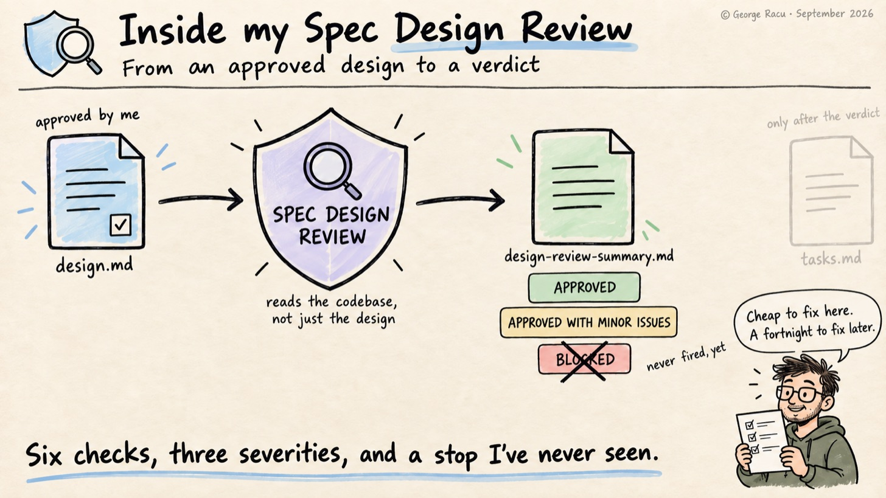
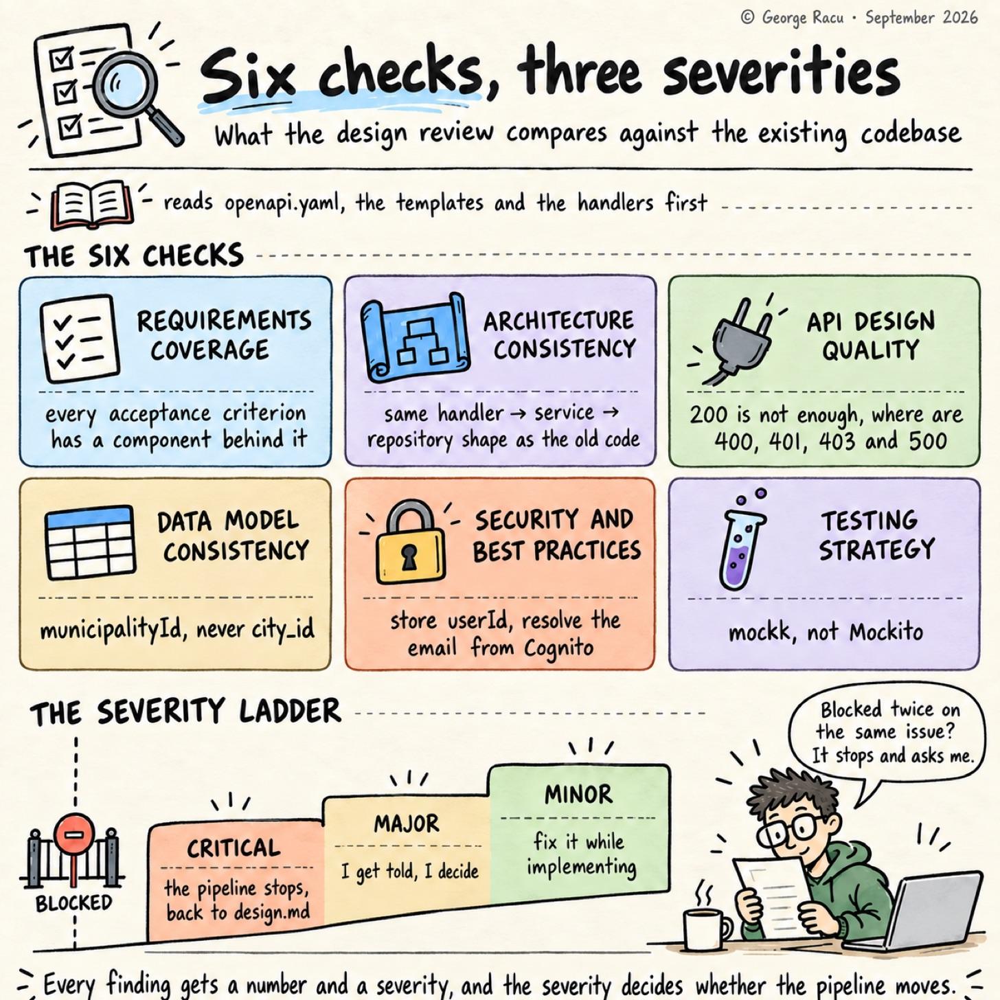
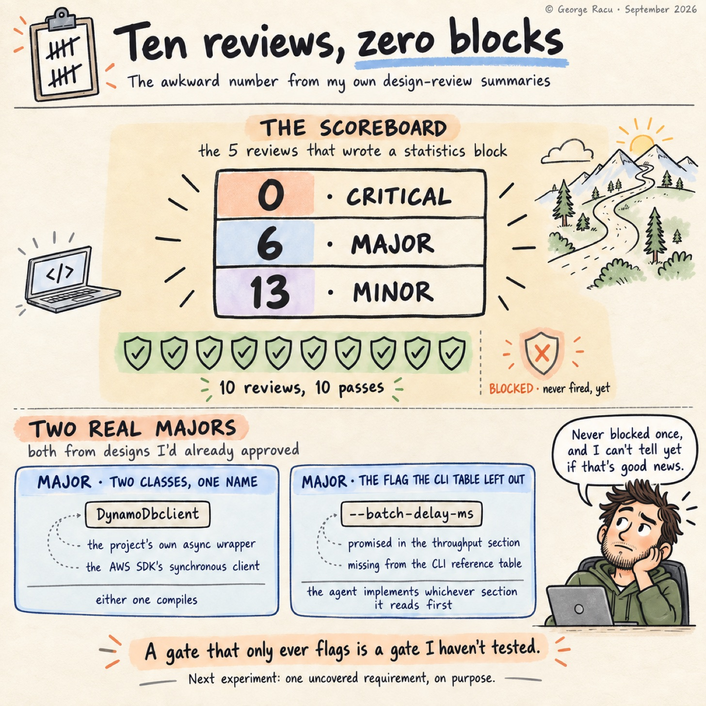

> Originally published on [Substack](https://georgeracu.substack.com/p/how-i-review-specs-against-the-codebase) on 16 September 2026.

## How I Review Specs Against the Codebase

The Spec Generator has two gates built into its workflow. This is about the first one: the design review. In my experience, a missed requirement costs almost nothing to fix while it’s still a gap in `design.md`, and the cost grows once it’s a deployed API with clients depending on the shape of the response. As there’s no check in between, it sits in the design, gets turned into tasks, gets implemented by an agent that had no reason to question it, and crashes in production the first time a user clicks it.

The Spec Design Review is how I catch that while it’s still cheap. The Spec Generator invokes `sdd:spec-design-review` automatically once I’ve approved `design.md`, and doesn’t go to `tasks.md` until the review returns a verdict.

## The Gate Sits Between design.md and tasks.md

The pipeline runs requirements, then design, then a stop:

    spec-generator Phase 1 → Phase 2 (design.md) → spec-design-review → Phase 3 (tasks.md)

The gate reads the requirements, the design, and then checks the codebase. But it only reads what the design actually touches: `openapi.yaml` and the existing handler patterns if the design adds endpoints, the infrastructure-as-code templates if it adds tables, the existing component patterns for frontend work, the auth service if it touches auth flows. An internally coherent design is useless if it doesn’t match the rest of the system.

I can also run it by hand, usually when a design has been sitting around for a week and I’ve completely forgotten how it works.

## Six Checks Against the Existing Codebase

The skill runs six checks, and each one compares the design with what the project already does rather than with a generic idea of good practice:

**Requirements coverage.** It pulls every acceptance criterion and checks that the design actually built a component, interface or data model for it. Correctness properties are supposed to carry a `**Validates: Requirements N.N**` trace, so the check is mechanical.

**Architecture consistency.** Compare proposed components against existing patterns: package names, class names, file locations, whether new services follow the same handler-to-service-to-repository shape as the old ones. The example the skill gives is a design proposing Spring-style `@RestController` annotations in a backend that uses `http4k` handlers, which is the sort of thing a model reaches for when it’s pattern-matching on “Kotlin backend” rather than on **this** Kotlin backend.

**API design quality.** Request and response schemas fully typed, HTTP methods and status codes conventional, error responses in the existing format, auth requirements stated, paths matching the existing naming. The recurring issue here is an endpoint that defines a `200 OK` and completely forgets that the rest of the project expects 400, 401, 403 and 500.

**Data model consistency.** Key naming and index conventions, entity names matching the glossary, ISO 8601 for dates, and no storing a second copy of something that already lives in another table. The example in the skill is a design proposing `city_id` in a system that has said `municipalityId` everywhere.

**Security and best practices.** Auth specified where needed, input validation at the boundaries, no sensitive data in logs or responses, cloud IAM at least privilege. The skill’s example is replicating a user’s email into a scan-results table when the existing pattern is to store `userId` and resolve the email from Cognito when needed.

**Testing strategy completeness.** Unit tests for business logic, integration tests for interactions, property-based tests aligned to the correctness properties, test file locations conventional, and mocking libraries matching what the project already uses. The skill’s example is a testing strategy that reaches for Mockito in a codebase that has used `mockk` throughout, and in my reviews so far that check has come back clean every time, as `kotest` plus `mockk` is what every design has proposed.

*Six checks against the codebase, three severities, one of which stops the pipeline.*

## Three Severities and a Stop

Every finding gets a severity, and based on the severity, it decides whether the pipeline moves.

`CRITICAL` means a requirement with no design support at all, a fundamental architectural misalignment, a security hole, or a missing core component, making the workflow stop: no `tasks.md`, no implementation, back to the design document.  
`MAJOR` means inconsistent patterns, incomplete API specs, naming contradictions, missing error handling, and I get to decide whether we stop.  
`MINOR` means I can fix it while implementing.

The output is a `design-review-summary.md` written into the spec directory next to the documents it reviewed, with a statistics block, the alignments it confirmed, every finding numbered `CRITICAL-001` and so on, an architecture-consistency assessment, and a checklist. If the same review comes back `BLOCKED` twice on the same issues, the skill stops looping and asks me.

## Two Major Gaps I’d Approved Already

Two findings from reviews in `project/work-items/`, with severity `MAJOR`, both from designs I’d already read and approved.

The first: a `ManifestRepository` constructor signature specifying `DynamoDbClient` without a package. The project contains two classes with that simple name, `com.georgeracu.gomi.bunrui.client.DynamoDbClient`, which is the project’s own wrapper around the async client and carries `AppConfig` and X-Ray tracing, and `software.amazon.awssdk.services.dynamodb.DynamoDbClient`, which is the AWS SDK’s synchronous one. Leave that to an agent, and it will guess. Either guess compiles, and only one works.

The second: a design that promised an inter-batch delay “configurable via `--batch-delay-ms`“ in its throughput section, while the CLI reference table further up didn’t list the flag. If an agent read the table first, that flag wouldn’t get built. A second read with a checklist catches that.

Both of those come from a private repository, so if you want to see one for yourself, check spec 38 in the `sdd-skills` repo, which sits as a worked example next to the requirements and design it reviewed. The verdict there was `APPROVED WITH MINOR ISSUES`, a gentler report than the two above, and `MINOR-003` is the kind of gap I mean. The requirement said the SLA page would state which municipalities are covered and update whenever that set changes, and the design named the copy key for the list without ever saying where the list comes from. A build-time JSON file, a runtime fetch from the rules index, or a content-ops pull request: three valid answers, and the design punted on choosing one.

## The Gate Never Blocked Me

This project has run 10 design reviews. Five wrote a statistics block, and across those five the tally is 0 `CRITICAL`, 6 `MAJOR` and 13 `MINOR`. The other five passed completely clean.

*10 reviews, 5 statistics blocks, and a BLOCKED verdict that never appeared.*

The optimistic take here is that the Spec Generator’s own context-gathering step does its job, so by the time a design reaches the gate the misalignments have already been designed out and only the fiddly stuff is left. The pessimistic take is that a gate that never blocks might just be broken.

Truth is probably in the middle. Before I claim the gate actually works, I really need to feed it a deliberately broken design to see if `CRITICAL` fires. I haven’t run that experiment.

If you have a design gate in your own workflow, try this: write a design with one acceptance criterion deliberately left uncovered, push it through, and see whether the gate blocks or merely flags. I’d like to hear which one yours does. The skill itself is in [sdd-skills](https://github.com/georgeracu/sdd-skills) under `skills/spec-design-review/`. The checks are the ones the `v0.1.0` tag shipped; the wording on `main` has since gone stack-neutral.

## Glossary

- **Gate**: a review skill invoked automatically between pipeline phases, returning `APPROVED`, `APPROVED WITH MINOR ISSUES`, or `BLOCKED`. Here it’s the design review, sitting between `design.md` and `tasks.md`.

- **Correctness property**: a statement in `design.md` about what must always hold, carrying a `**Validates: Requirements N.N**` trace back to the criteria it satisfies.

- **Secondary index**: a database index with its own key and projection conventions, which the data model check expects to match the existing tables.

- **MAJOR**: a finding that should be fixed for quality and consistency but doesn’t stop the pipeline.

## References

1. [Beyond Kiro: Engineering Quality Gates for AI Agents](/blog/articles/beyond-kiro-engineering-quality-gates-for-ai-agents/)

2. [Inside my Spec Generator: From a Half-Baked Brainstorm to Full Specs](/blog/articles/inside-my-spec-generator-from-a-half-baked-brainstorm-to-full-specs/)

3. [spec-design-review SKILL.md](https://github.com/georgeracu/sdd-skills/blob/main/skills/spec-design-review/SKILL.md) in sdd-skills, MIT, on `main`

4. [Spec 38 worked example](https://github.com/georgeracu/sdd-skills/tree/main/examples/38-source-fidelity-and-accuracy-sla) in sdd-skills: one feature’s brainstorm, requirements, design and `design-review-summary.md`, copied as they stand
