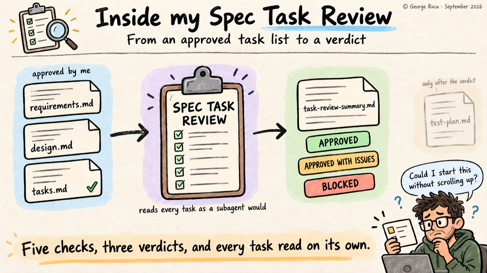
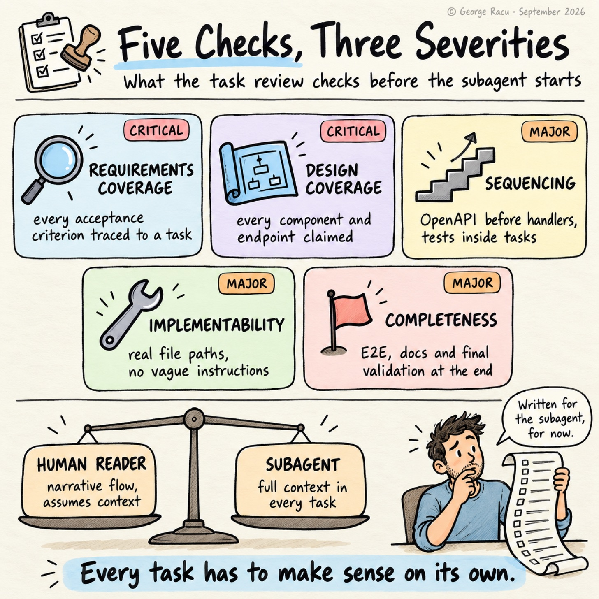
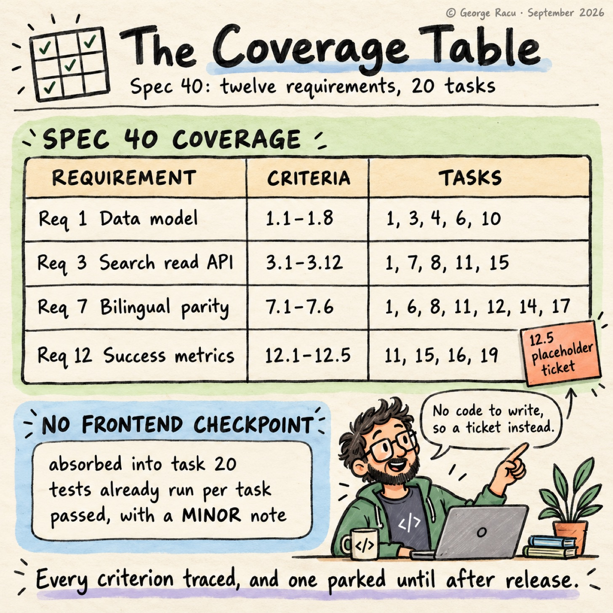

> Originally published on [Substack](https://georgeracu.substack.com/p/inside-spec-task-review) on 27 September 2026.

The one vague instruction my task review skill names by its text is “add appropriate error handling”. I can read that line and know what I meant, as I wrote the design and remember which caller I had in mind, but the same line allows a retry, a logged warning, a typed error, a cached fallback or a failed request, and a subagent has no way to tell which one I wanted. The subagent reads “appropriate”, picks one interpretation, and implements it with full confidence. This also matters when the LLM doing the implementation changes and each one has a different understanding of what “appropriate” means in this case.

The Spec Task Review is the second gate in my Spec Generator, and it reads `tasks.md` on the subagent’s behalf before any code gets written. My previous post covered the first gate, the design review, and this one covers what the task review checks, what five reviews in my own project show, and a question about who `tasks.md` is written for.

## The Gate Sits Between tasks.md and the Test Plan

`sdd:spec-task-review` runs once I’ve approved `tasks.md` and before `sdd:spec-qa-review` runs in plan mode. The QA planning pass sits between this gate and subagent-driven development, so the test plan gets written against an audited task list while there’s still no code to attach tests to.

The review reads three files from the work item, `requirements.md`, `design.md` and `tasks.md`, and ends in one of three verdicts. `APPROVED` sends the spec on to QA planning, `APPROVED WITH ISSUES` warns me and lets me proceed as long as nothing is CRITICAL, and `BLOCKED` sends me back to fix `tasks.md` and re-run the review, with the skill handing the decision to me if the same list is blocked twice.

`APPROVED` also retires the brainstorm. The skill deletes `brainstorm.md` from the work item, as once the tasks have been checked against the requirements and the design, the conversation that started all three has nothing left to add. On spec 40 the deletion went into the same commit as the gate result. The spec 38 worked example in `sdd-skills` shows the rule by its absence: the task review never ran on that feature, so there is no `task-review-summary.md` and `brainstorm.md` is still in the directory.

The review is a feature-only gate. Bugfix specs go straight from `tasks.md` to implementation, which I’ll come back to.

## Five Checks Against Two Documents

*Five checks, three severities, one verdict.*

**Requirements coverage.** The gate extracts every acceptance criterion from `requirements.md` and verifies that at least one task carries a matching `_Requirements: N.N_` trace. One task can cover several criteria with a comma-separated list, as long as the trace exists. A criterion with no task is CRITICAL, as in my pipeline a subagent only builds what a task names, so an untraced criterion never gets built.

**Design coverage.** The same sweep runs from the other direction. Every component, interface, endpoint and data model in `design.md` needs a task that implements it, and a missing one is also CRITICAL. Between the two checks the task list is pinned to both source documents, rather than to whichever one the generating agent had freshest in context.

**Sequencing.** The skill checks the build order: OpenAPI definitions before handlers, data models before service logic, backend before frontend integration, unit tests inside each task, integration and E2E tests at the end, and a checkpoint task every three to five implementation tasks. A dependency violation that would break the build is MAJOR, as a frontend task that runs before its OpenAPI contract and handler has no generated API types to import and no endpoint to call, so the TypeScript build fails or the subagent invents the response shape.

**Implementability.** Each task has to be clear enough that a developer could start without asking a question, reference file paths that exist on disk (or mark them as new), be sized for one subagent, avoid vague instructions, and carry enough context to be executed without reading the other tasks. That last requirement brings a lot of value, as a subagent picking up task 14 doesn’t have the conversation that produced tasks 1 to 13.

**Completeness.** The mandatory ending tasks have to exist: E2E tests where they apply, a documentation update, and a final validation that runs the full build and every test suite.

Severity follows from the check. Missing coverage is CRITICAL, sequencing errors, ambiguous tasks and missing ending tasks are MAJOR, and suggestions about splitting a task are MINOR.

## The Coverage Table I Always Read

*Every requirement in spec 40 traced to a task, with one criterion left as a placeholder.*

The gate writes `task-review-summary.md` next to the spec. The part I read first is the coverage table, which lists the tasks that claim each acceptance criterion.

Gomi Bunrui has five task reviews in its history, and spec 40, item-name text search, is the only one that reached `main` (the other four stayed on their feature branches). Its review shows the shape well. The spec had twelve requirements with acceptance criteria running from 1.1 to 12.5, and 20 tasks, and every criterion traced. Requirement 3, the search read API, has twelve criteria spread across five tasks. Requirement 12, success metrics, traces to four tasks, and the review flags 12.5 as a placeholder ticket to file at PR time, as a 30-day review after the feature flag goes on has no code to write. (The review reads `PASS` rather than `APPROVED` and groups the criteria by requirement, as Gomi Bunrui’s copy of the skill didn’t point at the summary template when it ran.)

Spec 40 is also where I saw the gate reason about a rule instead of counting. The frontend work had no checkpoint of its own, as the frontend checkpoint had been absorbed into task 20, the final validation. The gate passed the check and wrote down why: the frontend slices run their tests per task, so the safety net the rule asks for was already there. The review still raised the gap as a MINOR finding and suggested a local build and test run after task 12, which I think is right for a rule that was satisfied in spirit.

## The Gate Hasn’t Blocked Me Yet

Across the five reviews in Gomi Bunrui the gate raised no CRITICAL findings, no MAJOR findings and sixteen MINOR ones, so I have no rejection story from this gate to tell. Two feature specs never went through the gate at all. Specs 38 and 44 both got a `tasks.md` after I added the skill, and both have a design review but no task review, with `brainstorm.md` still in place. Spec 38 went all the way to the implementation audit without it.

The finding I’d grade differently is spec 40’s M2. Task 7 named three ways for the index handler to serve its file, a redirect to a CloudFront URL, the S3 object streamed through the Lambda, or API Gateway serving the S3 object directly, leaned towards the redirect, and left the final choice to the implementation with a note to record it in a handler comment. The skill lists ambiguous tasks as MAJOR, and the review graded this one MINOR, on the grounds that the right answer depended on how the codebase already served S3-backed reads.

The implementation went the other way. `ItemIndexHandler.kt` streams the S3 object through the Lambda, and its comment explains that SigV4-signed requests from Cognito Identity Pool clients don’t follow cross-origin redirects, so the redirect the task preferred would have broken the PWA’s index prefetch. The outcome was correct, but the decision lives in a code comment instead of `tasks.md` or `design.md`, where the next reader of the spec would look for it. A subagent picking up task 7 cold faced the exact choice the implementability check is meant to remove, and I’d rather the gate had pushed that choice back into the spec.

## Why Bugfixes Skip It

The bugfix pipeline has no gates at all. The flow is `bugfix.md`, `design.md`, `tasks.md`, then straight into implementation, with me reviewing each document as it appears.

The reasoning is blast radius. A bugfix spec has a Current Behaviour section, an Expected Behaviour section and an Unchanged Behaviour section listing what must not move, and that third section covers most of what a coverage check would catch. Two review gates on a small change would mean more paperwork than work, so I skip them on purpose.

The risk I watch for is a missing feature filed as a bug. A real defect has a correct behaviour I can write down before I start. When I find myself designing the correct behaviour instead of describing it, the work belongs in the feature pipeline, and staying in the bugfix one means skipping both gates.

## Should a Task Copy the Design or Point at It?

Who is `tasks.md` for? On spec 40 the answer was the subagent, as the Phase 8 dispatch turned the tasks into child issues in Paperclip, one issue per task, each queued behind its real predecessors. A task that goes out as its own issue has to stand on its own, which is why the implementability check asks for file paths, the endpoint, the auth model and the test command in every task.

The cost shows in the size. Spec 40’s `tasks.md` runs to 5,066 words against 5,852 for `design.md`, and single tasks run from 53 words (the backend checkpoint) to 400 (the observability task). The task list is close to the length of the design it came from.

For now I accept that `tasks.md` is a machine-facing document and `design.md` carries the story. What I haven’t settled is whether that length is the price of dispatching tasks one at a time, or a sign that each task should point at its section of `design.md` instead of carrying the context itself.

## Where I’m Taking It Next

I’m still working out where the implementability check should stop, and spec 40’s M2 is the case I keep coming back to. The QA review skill comes next in the pipeline, and it runs twice: once in plan mode before any code exists, and once in review mode afterwards.

If your workflow looks anything like mine, take one task list you’ve already written and read each task as if you’d never seen the others. The tasks you can’t start without scrolling up are the ones a subagent will guess at.

## Glossary

- **Acceptance criterion**: one numbered, testable statement under a requirement, written in EARS notation.

- **Requirement trace**: the `_Requirements: N.N_` marker on a task, linking it to the criteria it satisfies.

- **Checkpoint task**: a task that runs the full build and all tests, placed every three to five implementation tasks.

- **Blast radius**: how much of the system a change can plausibly break. Here it’s what decides whether a spec goes through the gates.

- **Paperclip**: the issue board my agents pick work up from. Here each task in spec 40 became its own Paperclip issue.

## References

1. [Beyond Kiro: Engineering Quality Gates for AI Agents](/blog/articles/beyond-kiro-engineering-quality-gates-for-ai-agents/)

2. [Inside my Spec Generator: From a Half-Baked Brainstorm to Full Specs](/blog/articles/inside-my-spec-generator-from-a-half-baked-brainstorm-to-full-specs/)

3. [How I Review Specs Against the Codebase](/blog/articles/how-i-review-specs-against-the-codebase/)

4. `spec-task-review/SKILL.md` in sdd-skills

5. [Spec 38 worked example](https://github.com/georgeracu/sdd-skills/tree/main/examples/38-source-fidelity-and-accuracy-sla) in sdd-skills, the one public work item, with no `task-review-summary.md` because this gate never ran on it
