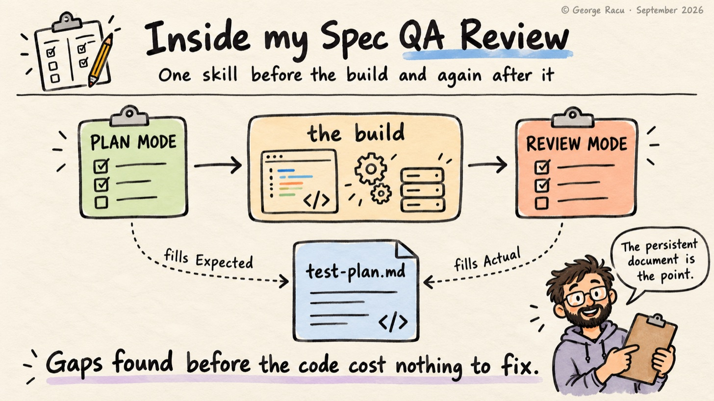
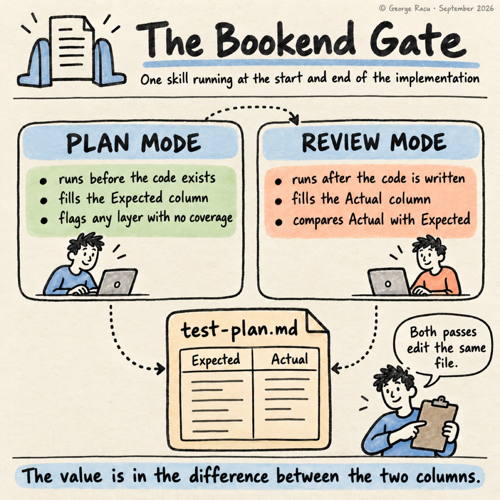
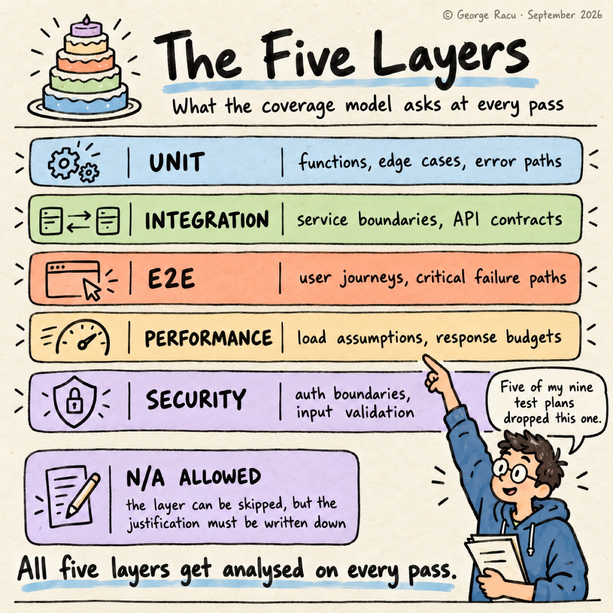

> Originally published on [Substack](https://georgeracu.substack.com/p/inside-spec-qa-review) on 1 October 2026.

## How I Plan Tests Before the Code Exists

The core principle at the top of my QA skill is a single line: **test coverage gaps found before writing code cost nothing to fix, and gaps found after cost a lot**. I agree with that line every time I read it, and for years my own habit was to think about tests once there was code to test, by which point the design had already decided which boundaries could be mocked and which failure modes I hadn’t modelled.

So what does a skill look like that makes me answer the testing question while the design is still cheap to change, and did my agents do what it asks? My previous post covered the task review, the gate that checks `tasks.md` before a subagent reads it. This one covers `sdd:spec-qa-review`, the skill that runs straight after that gate and again at the end of the build, and what nine test plans in my own project show about how closely the agents followed it.

## One Skill Runs at Both Ends of the Build

`sdd:spec-qa-review` is the only skill in the pipeline that runs twice.

**Plan mode** runs once `sdd:spec-task-review` passes. The skill reads `requirements.md` and `design.md`, works out what should be tested at each of five layers, and writes `test-plan.md` into the work item with the Expected column filled in and the Actual column empty. Any layer with zero expected coverage gets flagged as a gap straight away, which is the check that catches “I’ll think about performance later” before the implementation starts.

**Review mode** runs much later, after `sdd:spec-implementation-audit` passes. The pass reads the tests and the source, fills the Actual column, compares it with Expected, and updates the gap log in the same `test-plan.md` rather than starting a new document. The skill requires that file, as a gap report that only lives in the conversation is gone once the session ends, and in the skill’s own words, “The persistent document is the point.”

*Plan mode fills Expected, review mode fills Actual, and both edit the same file.*

If the mode is ambiguous, which happens with a partly implemented spec, the skill asks me rather than guessing, and I can force either one with “qa-review plan” or “qa-review review”.

## Five Layers, None Skipped Without a Reason

**LayerWhat the skill asks**UnitFunctions, components, edge cases, error paths, with a ≥85% line and branch coverage gateIntegrationService boundaries, API contracts, data flow between layersE2EUser journeys, happy paths, critical failure pathsPerformanceLoad assumptions, response time budgets, bundle and memory sizeSecurityAuth boundaries, input validation, sensitive data exposure, OWASP Top 10 relevance

All five layers get analysed on every pass. A layer can be marked N/A, and the skill wants the justification written down, so “no unit tests, pure infrastructure” is allowed and a bare “no unit tests” isn’t.

*The five layers, and the N/A rule that makes every skip carry a written reason.*

The skill is as specific about severity: Critical, Important and Minor, and never High/Medium/Low or P0/P1/P2. I wrote that rule so that every QA artefact would use the same scale, and the spec 38 QA review shows how well it held. The verdict reads “0 CRITICAL, 0 MAJOR, 1 new MINOR”, and the open gaps further down are marked Important, which gives two scales in one file, with MAJOR borrowed from my design and task reviews.

## What the Skill Refuses to Write

The skill has a section headed “IMPORTANT: What This Produces”, and that section lists what the output must leave out: test case tables, requirement traceability matrices and lists of property-based tests. The output is a coverage analysis that answers one question per layer, what is tested and what should be.

The block has been in the skill since the first version I committed, before any of my test plans existed. I wanted a matrix with an Expected column and an empty Actual column, as that’s a document that gets filled in later and shows the difference, while a test case table tends to get written once and not read again.

## Nine Test Plans, Two That Follow the Skill

It was time to check what the agents had written. My Gomi Bunrui project has nine feature test plans, written in about four months, and I read the layer list and the coverage matrix of each one.

- Two use the five layers as the skill names them: spec 28, the first plan, and spec 37.

- The other seven invent layers of their own. Contract appears in six of them, accessibility in five, and i18n, property-based and infrastructure layers turn up once or twice each.

- Performance drops out of the layer list in five plans: specs 38, 41, 43, 44 and AIW-150.

- Test case tables appear in most of them. The spec 40 plan runs to 6,224 words and 253 numbered test rows.

- Spec 37 is the only plan where review mode came back and filled the Actual column. Specs 38 and 43 got their verdict in a separate `qa-review.md` instead.

## The Spec 38 Plan, Line by Line

The plan I’d picked for the worked example was spec 38 (source fidelity and the accuracy-update SLA), and it’s now public in `sdd-skills` along with its QA review, so you can check each deviation against the documents.

The matrix rows read Unit, Contract, Integration, E2E and axe-a11y. Security moved out of the matrix into a control-by-control table further down, and Performance is gone.

The body is the artefact the skill forbids, with tables of test cases scenario by scenario. `FS-1` is `lastVerifiedAt` 89 days ago with no published rule change, expecting `WITHIN_SLA`; `FS-2` is 91 days, expecting `STALE`; `FS-5` is null, expecting `UNAVAILABLE`.

Review mode never came back to the plan. The status still reads Draft, the last update is the day the file was created, and every Actual cell reads Pending. The verdict landed ten days later in `qa-review.md`, with a matrix of its own.

I started out ready to defend the drift. Contract and axe-a11y fit a feature that’s an API with an accessibility surface, and the test case tables are the reason I can tell you the SLA boundary is 90 days and the change-response window is 14 without opening the code. Then I read the design again, and its Performance Considerations section sets a latency invariant for the hot path, which is the reason the freshness fields live on the existing item rather than in a second table. The design named a performance risk, the plan dropped the layer that would have tested it, and the QA review ten days later had no Performance row either.

## The 85% Gate Fired and Came Back Minor

The unit coverage gate is 85% because 85 sounded defensible when I wrote the skill, and I have no evidence that 85 beats 80. The skill on `main` says as much, calling it a project default I can move in the template.

On spec 38 the gate had something to do. The QA review measured line coverage on four classes the spec touched: 81.1% on `FreshnessService`, 84.7% on `AdminRouter`, 71.4% on `ScanFeedbackService` and 0% on `RulesService`, where the planned freshness tests were never added. The skill calls coverage below the gate Critical, and the review classified it MINOR, because the E2E tests were green and it found no untested safety-critical path, then passed the gate.

I can follow that reasoning. The number still decided nothing on spec 38, as once coverage fell below 85, the review weighed the other layers and made its own call.

## Enforce the Rule or Adopt the Drift

I’m leaving the spec 38 plan in `sdd-skills` exactly as the agent wrote it, and the drift splits into two piles for me. Contract and accessibility turned up as layers in most of the later plans, so I’d rather the skill named them than leave every agent to invent them. A plan that drops Performance when the design sets a latency invariant, a review that never updates the plan and a severity scale borrowed from another gate belong in the other pile, the one I tighten. The test case tables are the question I haven’t settled, as the skill forbids them and they’re the most useful part of the spec 38 plan.

If you have agents writing test plans, open the last few and compare the layer list with the one you asked for. I’d like to hear which layers your agents added and which ones they dropped.

## Glossary

- **Plan mode**: the pass before implementation that fills the Expected column of the coverage matrix.

- **Review mode**: the pass after the implementation audit that fills the Actual column and compares it with Expected.

- **Coverage gate**: the 85% line and branch threshold on the unit layer, a project default.

- **Gap log**: the table in `test-plan.md` that records each gap, its severity, and when it opened and closed.

- **Contract test**: a test that checks an endpoint against its API definition. Here it’s the `openapi.yaml` checks in the spec 38 plan.

- **axe**: an automated accessibility checker. Here the spec 38 plan turns it into a layer of its own, `axe-a11y`.

## References

1. [Beyond Kiro: Engineering Quality Gates for AI Agents](/blog/articles/beyond-kiro-engineering-quality-gates-for-ai-agents/)

2. [Inside Spec Task Review](/blog/articles/inside-spec-task-review/)

3. `spec-qa-review/SKILL.md` in sdd-skills

4. [Spec 38 test plan](https://github.com/georgeracu/sdd-skills/blob/main/examples/38-source-fidelity-and-accuracy-sla/test-plan.md) in sdd-skills, the plan mode output discussed above, copied as it stands

5. [Spec 38 QA review](https://github.com/georgeracu/sdd-skills/blob/main/examples/38-source-fidelity-and-accuracy-sla/qa-review.md) in sdd-skills, the review mode verdict with the coverage figures
