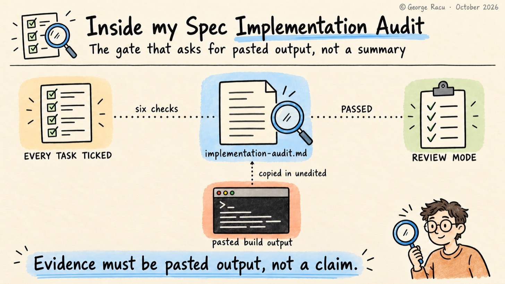
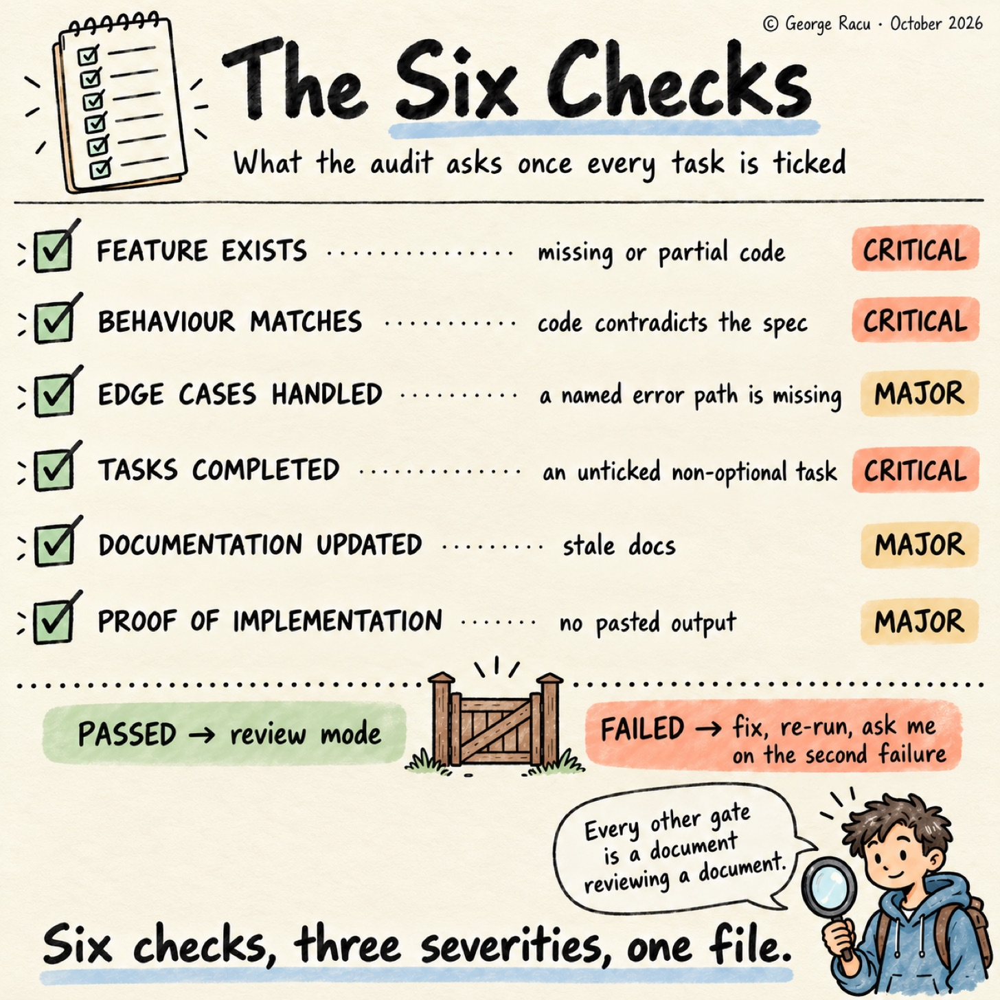
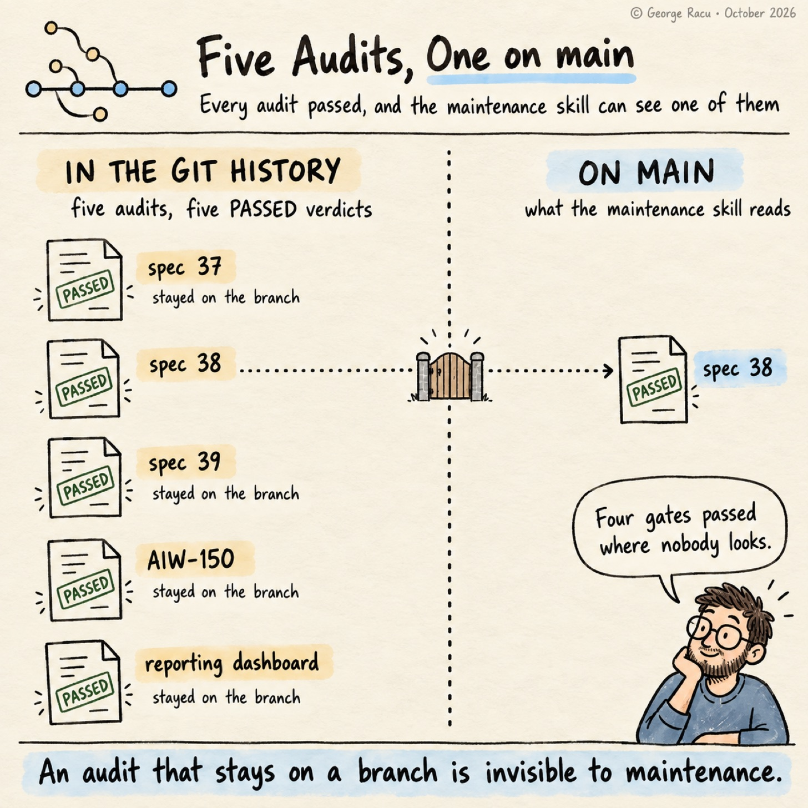

> Originally published on [Substack](https://georgeracu.substack.com/p/inside-spec-implementation-audit) on 9 October 2026.

## How I Check What the Agent Says It Built

Every task report I get back from a subagent says the task is done, and the report reads the same whether the work is complete or whether the agent decided halfway through that one requirement was out of scope. I’ve had a run of tasks come back with every box ticked and a cheerful summary, and found a requirement implemented as a comment saying it would be implemented.

I put this down to how the work gets sliced. A subagent finishing task 11 knows it finished task 11, and has no view of whether the eleven tasks together add up to what the spec asked for, so somebody has to hold the whole spec next to the whole codebase and check. My previous post covered `sdd:spec-qa-review`, the skill that plans tests before the build and grades them after it. This one covers `sdd:spec-implementation-audit`, the gate that runs once, after `subagent-driven-development` finishes the last task and before the QA review’s second pass, and what the five audits my agents wrote show about how well it holds.

## Six Checks, Three Severities

**Feature exists.** For every requirement in `requirements.md`, the audit finds the code, wherever the project keeps its frontend source, its backend source and its infrastructure templates, plus the contracts in `openapi.yaml`. A requirement with no code is CRITICAL, and so is a partial one, which is the rule that catches the comment-shaped implementation. I added that second sentence on the day I committed the skill in April, as the first version flagged missing code and said nothing about incomplete code.

**Behaviour matches.** Present and correct are different questions, so the second check reads the API contracts against the endpoint specifications in `design.md`, the data models against the schemas, the business rules against the acceptance criteria and the error responses against the specified codes and messages. Code that contradicts the spec is CRITICAL, and in my experience it’s more common than absence, as an agent that half-understood a requirement still produces something plausible.

**Edge cases handled.** The error paths named in `requirements.md` exist, validation sits at the system boundaries, and graceful degradation is where the spec put it. A missing edge case is MAJOR.

**Tasks completed.** Every non-optional task in `tasks.md` is ticked, and optional tasks, the ones with a `*` prefix, are noted as skipped or done. An unticked non-optional task is CRITICAL. The check sounds mechanical, and it’s there for the agent that ran out of context, stopped, and summarised as though it hadn’t.

**Documentation updated.** Architecture docs reflect any design change, `openapi.yaml` is current, the knowledge base has any new pattern and auto-memory has any changed convention. Stale docs are MAJOR.

**Proof of implementation.** The audit runs whatever build and test commands the project documents in its `AGENTS.md` or README, backend and frontend, plus the E2E suite and the type-generation script where the project has them, and pastes the output into the audit document. The instruction is one line: “Evidence must be actual pasted output, not claims like ‘tests pass’.” Every other gate in the pipeline is a document reviewing a document, and this is the one place where something gets executed and the result copied in unedited. Missing evidence is MAJOR, and style issues and small naming inconsistencies are MINOR.

## One File, Two Jobs

The audit writes `implementation-audit.md` into the work item, following the project’s gate template where there is one: a per-requirement table with a status and the evidence for each acceptance criterion, a task completion count, numbered discrepancies in expected-versus-actual form, the pasted build and test output, and a verdict of PASSED or FAILED.

PASSED moves on to `sdd:spec-qa-review` in review mode. FAILED dispatches fix subagents at the specific gaps and re-runs the audit, and a second failure stops and asks me, which is the two-strike rule every gate in this pipeline uses.

The file has a second job, and it took me a while to notice it. `sdd:spec-maintenance` decides which work items count as implemented by checking whether `implementation-audit.md` exists in their directory, so the audit is also the marker that puts a spec into the population that later maintenance passes check for drift. A spec that skipped the audit is invisible to every maintenance run that follows.

## Five Audits Written, One on `main`

It was time to count. The `main` branch of Gomi Bunrui holds ten design reviews and five test plans under `project/work-items/`, and one implementation audit, for spec 38.

I’d assumed that meant the agents ran the audit once. The git history says five times, and all five passed. Spec 37 got an audit backfilled in May, spec 39 got one for its fourth slice, AIW-150 got one for its first slice in June, and the reporting dashboard got one in late June. None of the four reached `main`. The reporting dashboard and AIW-150 work items sit on branches that never merged, and specs 37 and 39 merged without their audit files coming along.

A maintenance pass run from `main` therefore has one implemented work item to compare the current spec against, in a project with 48 work item directories. The eleven work items whose task lists are fully ticked with no audit don’t change that picture, as all eleven were completed by early April, before the skill existed, and the two bugfix work items never had an audit to skip, as the bugfix pipeline runs no gates at all.

## The Audit I Have, Line by Line

The spec 38 audit is public in `sdd-skills`, along with the `tasks.md` it audited, so the two deviations below are checkable. The agent verified all ten commit hashes in the status table at the bottom of `tasks.md` against `git log main..HEAD`, cited file and line for each of the seven correctness properties in the design, and spot-checked the infrastructure template, the Cognito deny rules, the admin router and the frontend component. It also counted the test cases (twelve on `AdminRouter`, ten on `FreshnessService`, eight on `RulesService`, ten on `ScanFeedbackService` and 20 on `SourceCitation`), and passed the gate with four MINOR findings, all of them naming and wording drift between the spec and the code.

The first deviation is that the evidence section has no pasted build output anywhere in the file. Commit hashes that resolve and file-and-line citations are evidence of a kind, but the skill asks for pasted output.

The second is the task check. Open `tasks.md` for spec 38 and eighteen of the nineteen checkboxes are unticked, with task 19, the final validation, the only one ticked. The status table further down the same file marks all nineteen done with a commit hash each, and the audit read the table rather than the boxes. By the skill’s own rule, eighteen unticked non-optional tasks are eighteen CRITICAL findings, and the audit reported none. The agent picked the stronger evidence, as a commit hash that resolves says more than a tick, and the version of the skill in `sdd-skills` doesn’t know the table exists.

## Which Evidence Counts

I’m leaving the spec 38 audit in `sdd-skills` as the agent wrote it, and the two deviations get different treatment. The task check I’ll loosen, so that a status table with commit hashes that resolve counts as completion evidence, as that’s what the agents produce and it’s stronger than a tick. The missing build output I’ll tighten, as the skill says pasted output, the audit passed without it, and I didn’t notice until I reread the file.

The four audits that never reached `main` are the finding I didn’t expect. Each one is a gate that passed on a branch, and the marker that would have told the maintenance skill about it stayed on the branch too. The fix I’m going to try is a merge rule rather than a skill change: a work item directory reaches `main` with its audit, or the branch doesn’t merge.

If your agents write audits, count the ones on your default branch and the ones in your git history, and compare the two. I’d like to hear whether the gap is as wide as mine.

## Glossary

- **Optional task**: a task marked with a `*` prefix in `tasks.md`, which the audit expects to see explicitly skipped or completed rather than silently ignored.

- **Two-strike rule**: the pipeline-wide pattern where a failed gate is fixed and re-run once, then escalated to the human.

- **Proof of implementation**: pasted command output in the audit document, as distinct from an assertion that a command succeeded.

- **Status table**: the summary table at the bottom of a `tasks.md` that records each task’s state and commit. Here it’s the table the spec 38 audit verified instead of the checkboxes.

## References

1. [Beyond Kiro: Engineering Quality Gates for AI Agents](/blog/articles/beyond-kiro-engineering-quality-gates-for-ai-agents/)

2. [How I Plan Tests Before the Code Exists](/blog/articles/inside-spec-qa-review/)

3. `spec-implementation-audit/SKILL.md` in sdd-skills

4. [Spec 38 implementation audit](https://github.com/georgeracu/sdd-skills/blob/main/examples/38-source-fidelity-and-accuracy-sla/implementation-audit.md) in sdd-skills, the one audit on `main`, copied as it stands

5. [Spec 38 task list](https://github.com/georgeracu/sdd-skills/blob/main/examples/38-source-fidelity-and-accuracy-sla/tasks.md) in sdd-skills, with the eighteen unticked boxes and the status table
