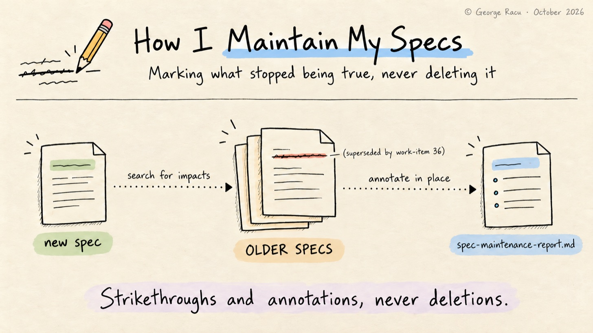
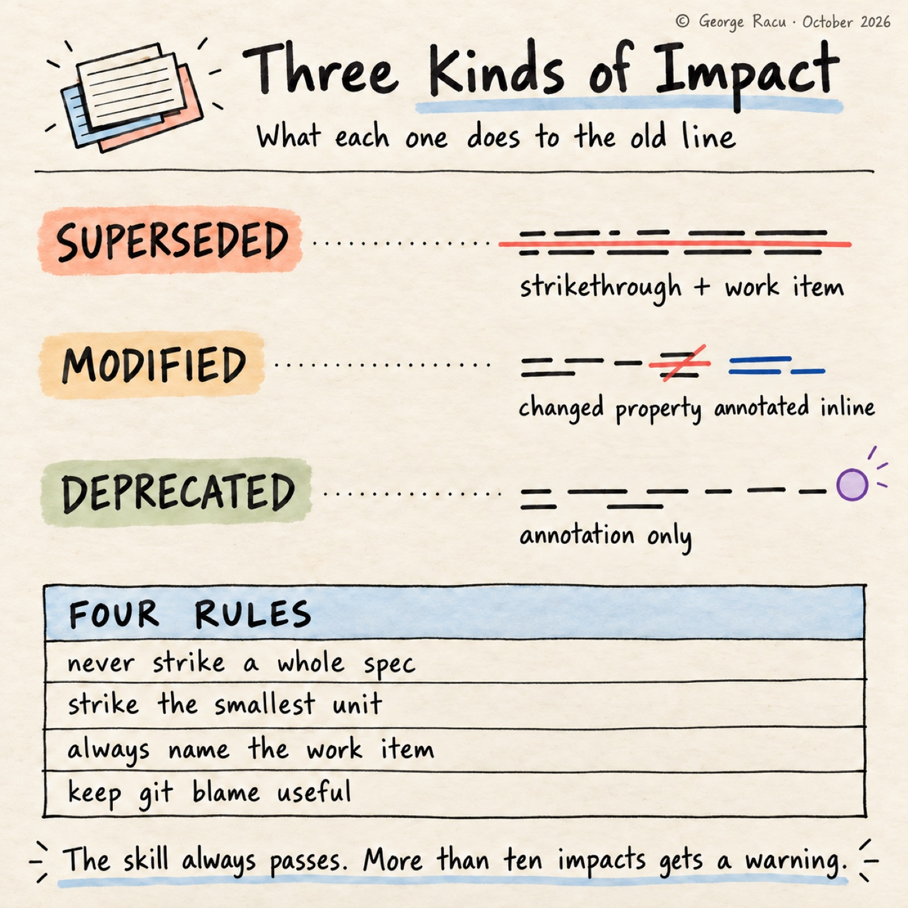
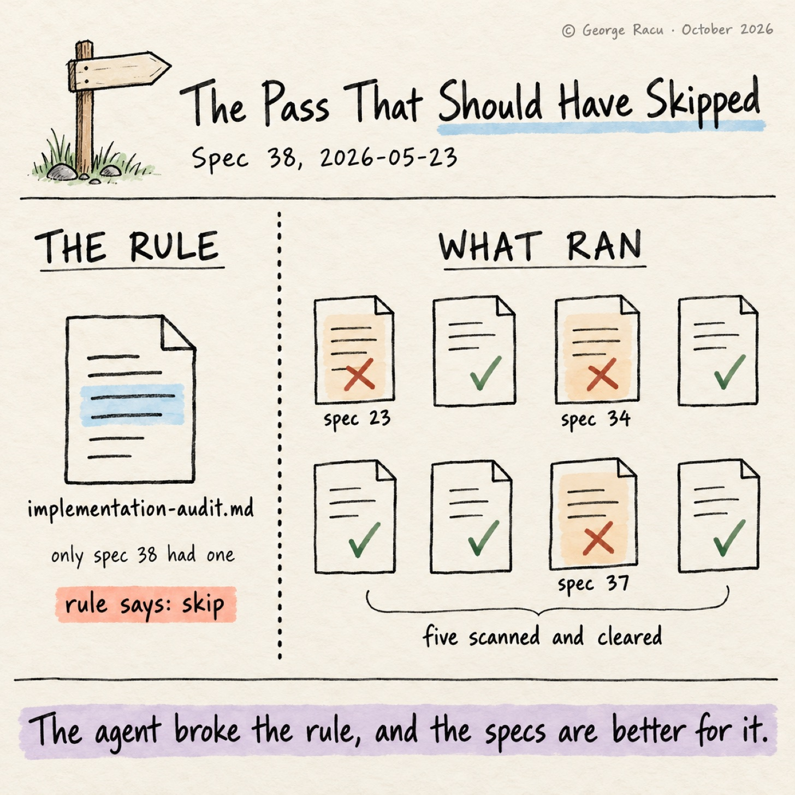

> Originally published on [Substack](https://georgeracu.substack.com/p/how-i-maintain-my-old-specs-when) on 17 October 2026.

I don’t re-read old specs unless I’m already confused. A spec is accurate the day it’s implemented, and a few features later parts of it describe a system that no longer exists, without a word of the spec changing and without anything telling me. Code that describes a system that no longer exists tends to stop compiling, while a spec has no compiler and no tests, so the only thing that keeps it current is something going back to it on purpose. In my case that something is a skill.

`sdd:spec-maintenance` runs after the QA review’s review mode passes and before the branch is finished, and its job is to find which previously implemented specs the finished work has made wrong.

## Implemented Means an Audit File Exists

The skill has one test for history: a work item is implemented if its directory contains an `implementation-audit.md`. Anything without one is excluded from the analysis, so the previous gate doubles as the membership list, and I don’t have to keep a status field up to date.

If no other implemented work item exists, the skill skips itself and hands over to `finishing-a-development-branch`.

## Five Steps and a Report

**Step 1: Identify scope.** The skill reads the current spec’s `requirements.md`, `design.md` and `tasks.md` and builds a summary of what changed: new or modified endpoints, data models, components, business rules and infrastructure.

**Step 2: Search for impacts.** For each change, it searches the previous specs for overlapping concerns with Grep and Glob, or with the project’s own search skill if one is installed, then reads the sections that came back to decide whether each hit is a real impact. A semantic index helps here, as an older spec rarely uses the same words as the new one.

**Step 3: Classify.** There are three kinds of impact. *Superseded* means the current spec replaced the item entirely, and it gets a strikethrough plus an annotation. *Modified* means some details changed, so the text stays and the changed property is annotated inline. *Deprecated* means it still works but is no longer the recommended approach, and it gets an annotation with no strikethrough, as striking through something that still runs in production would make the spec wrong in the other direction.

**Step 4: Annotate.** The skill edits the old files in place, and its own example is a task that a later work item replaced:

    - [x] ~~Task 3: Implement prompt template loader~~ *(superseded by work-item 36)*

**Step 5: Report.** It writes `spec-maintenance-report.md` into the current work item, on the project’s gate template where there is one, listing every impacted work item, every file changed and every annotation, plus the specs it analysed and found not impacted.

## Four Rules on What It Can Touch

Four granularity rules limit the edits. The skill never strikes through a whole spec file, as declaring a whole spec obsolete is a new spec’s job. It strikes the smallest unit that changed, a bullet or a single acceptance criterion, never the parent heading. Every annotation names the work item that caused it, so each one traces back to a decision. And it makes minimal edits without reformatting the text around them, as a pass that rewrapped every paragraph would wipe the `git blame` history it’s there to keep.

The skill has no severity levels and no gate behaviour, and it always passes, as stale specs are information rather than a reason to block a merge. The one exception is volume: more than ten impacts across several specs gets a warning to me, as that much churn in older specs says more about architectural drift than about documentation. Ten is the default, and a project can set a different bar in its template.

## The Spec 38 Pass

Spec 38, source fidelity and the accuracy-update SLA, has the one maintenance report on `main`. The report is public in `sdd-skills` as part of the spec 38 worked example, and the three specs it annotated are not, so what follows is the report’s account of them.

Spec 38 added per-result source citations, freshness metadata, a public SLA, breach detection and a link into scan feedback, and it extended interfaces that three earlier specs describe. Spec 23, the recycling rules API, got two inline annotations in its `design.md`: `MunicipalityRulesResponse` gained a non-nullable `freshnessMeta` field, and the DynamoDB META item at `PK=MUNICIPALITY#{id}, SK=META` gained six freshness attributes.

Spec 37, classification feedback, got two in its `design.md`, one for a new nullable `slaState` on the `ScanFeedbackRequest` DTO, rejected with a 400 on invalid values, and one adding `slaState` to the scan-feedback table schema. Spec 34, municipality data seeding, already had a note in its `tasks.md` from an earlier pass, recording that seeded items show `slaState: unavailable` until an operator writes freshness data, with no automated backfill.

The report counts ten items annotated or amended across four work items, six of them in spec 38’s own documents, and raises no drift warning. None of it is dramatic, and it’s the kind of detail I’d otherwise rediscover by reading spec 23, trusting the shape of `MunicipalityRulesResponse`, and not finding the field I needed.

## The Pass That Should Have Skipped Itself

It was time to check the membership test. The spec 38 maintenance pass ran on 2026-05-23, and when it ran, spec 38’s own `implementation-audit.md` was the only one in my work items. No other work item counted as implemented, so by its own rule the skill should have skipped itself. The agent scanned eight earlier specs instead, none of which had an audit file, annotated two, confirmed an earlier note on a third and cleared five, and the annotations are correct.

The agent broke the rule and the specs are better for it, which is the same thing that happened with the task check in the spec 38 audit, where the agent read the status table instead of the checkboxes. In both cases the rule asks for a marker that the pipeline doesn’t reliably leave where the next skill looks.

Most of the other passes in my history found nothing to annotate, which matches my sense of the skill.

## What Is Changing, and What I Haven’t Solved

The membership rule is changing. The next version reads the audit’s status line, so a work item counts as implemented when its `implementation-audit.md` says `PASSED`, and the current item’s own audit no longer counts.

The other change is the trigger, which I haven’t solved. Running maintenance at the end of every spec keeps the older specs current and spreads the cost thin, but the skill only sees impacts a single spec caused. The drift I worry about is cumulative, where no single change invalidated an old spec but four changes together did, and nothing in this pipeline looks for that yet.

If your agents keep specs, pick one implemented a few months ago and check one endpoint in it against the code. I’d like to hear how far yours drifted.

## References

1. [Beyond Kiro: Engineering Quality Gates for AI Agents](/blog/articles/beyond-kiro-engineering-quality-gates-for-ai-agents/)

2. [How I Check What the Agent Says It Built](/blog/articles/inside-spec-implementation-audit/)

3. `spec-maintenance/SKILL.md` in sdd-skills, at the commit this post describes

4. [Spec 38 maintenance report](https://github.com/georgeracu/sdd-skills/blob/main/examples/38-source-fidelity-and-accuracy-sla/spec-maintenance-report.md) in sdd-skills, the pass discussed above, copied with one local path shortened
