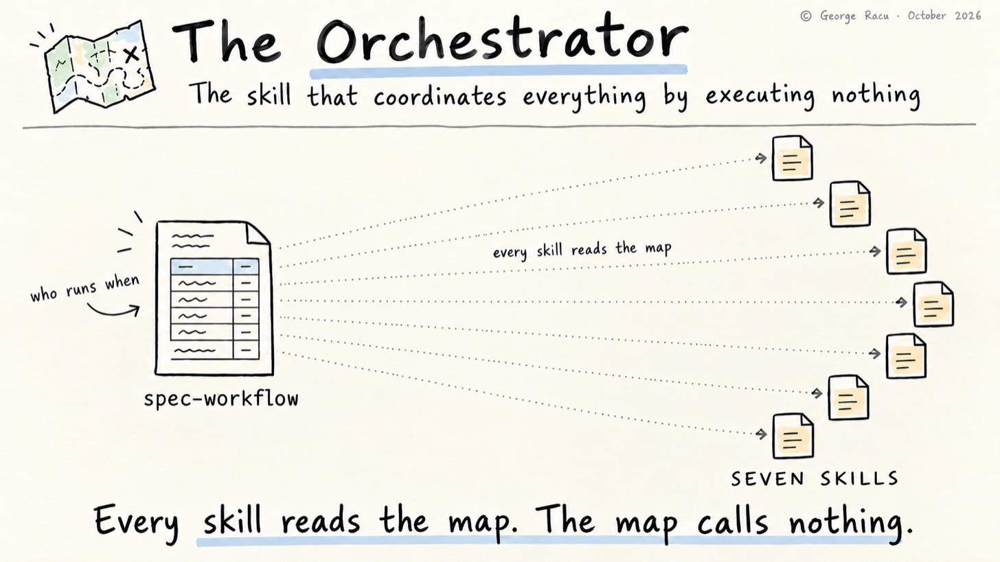
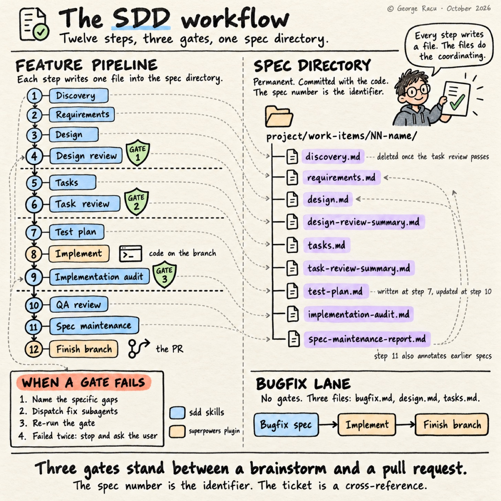

> Originally published on [Substack](https://georgeracu.substack.com/p/inside-spec-workflow) on 20 October 2026.

## The Orchestrator: How the Seven Skills Stay in Line

Every workflow engine I’ve built has followed the same trajectory. It starts as a coordinator that calls things in order, grows conditionals as the real world intrudes, acquires state so it can remember where it got to, and ends up as the most complicated component in the system, the one nobody wants to touch, and the one that breaks in a way that takes down everything downstream.

The workflow skill in this pipeline avoids all of that by doing nothing. It calls no skills, holds no state, makes no decisions. The skill is a document that says who runs when, and every other skill ends by naming the step it hands to, so the two have to agree.

I’ve called it the orchestrator throughout this series out of habit, and the first line of the skill corrects me: it documents ordering and override rules, and does not orchestrate.

## The Feature Pipeline: Twelve Steps

**StepSkillOutput**1`sdd:spec-discoverydiscovery.md`2`sdd:spec-generator` Phase 1`requirements.md`3`sdd:spec-generator` Phase 2`design.md`4`sdd:spec-design-review` (gate)`design-review-summary.md`5`sdd:spec-generator` Phase 3`tasks.md`6`sdd:spec-task-review` (gate)`task-review-summary.md`7`sdd:spec-qa-review` plan mode`test-plan.md`8`subagent-driven-development` (superpowers)Implementation9`sdd:spec-implementation-audit` (gate)`implementation-audit.md`10`sdd:spec-qa-review` review modeUpdated `test-plan.md`11`sdd:spec-maintenance`Updated previous specs, `spec-maintenance-report.md`12`finishing-a-development-branch` (superpowers)PR

Ten of those twelve steps belong to SDD, three of them the spec generator’s own phases and two the QA skill running in its two modes, and the remaining two are superpowers skills that SDD borrows rather than reimplements. Every step names its output file, which is what lets a skill starting cold work out where it is: read the directory, see which artefacts exist, and the pipeline position falls out. The spec 38 worked example in `sdd-skills` is one such directory: nine of the twelve steps left a file there, and the README records which three did not and where the artefacts diverge from the skill text.

*Twelve steps on the left, the file each one writes on the right. Steps 8 and 12 write nothing into the directory.*

The bugfix pipeline is three steps and no gates. Generate `bugfix.md`, `design.md` and `tasks.md`, implement, finish the branch. I still review each document as it appears, so the human gate stays; it’s the automated ones that go.

## The Override Rules

The SDD skills sit on top of superpowers, which has its own opinions about what follows what, and four rules, two of which bend those defaults, state the order where the two meet:

- For a feature, start with `sdd:spec-discovery` rather than `brainstorming`, and after either invoke `sdd:spec-generator` rather than `writing-plans`

- After `subagent-driven-development`, invoke `sdd:spec-implementation-audit` rather than `finishing-a-development-branch`

- After the QA review’s review mode passes, invoke `sdd:spec-maintenance`

- After `sdd:spec-maintenance`, invoke `finishing-a-development-branch`

The exception is the bugfix pipeline, which follows the default chaining and goes straight from implementation to finishing the branch.

These four lines are the entire integration between two skill systems. They’re also the reason nothing had to be forked: superpowers keeps its own defaults for everyone else, and SDD states its deviations in one place where they can be read, argued with, and changed.

## Gate Failure: One Pattern, Three Gates

Every gate fails the same way, which turns out to matter more than any individual gate’s rules:

1. The gate identifies specific gaps

2. Fix subagents get dispatched at those specific gaps

3. The gate re-runs

4. If the loop fails twice on the same gate, stop and ask the human

That fourth step is the one I’d fight to keep. Without it, a gate and a fixing agent can trade attempts indefinitely, each pass looking locally like progress, and the failure is a slow drain of tokens. Two strikes and it comes back to me.

## What I Didn’t Design For

Making the pipeline declarative means the agent can read the map and place itself, which has a property I didn’t design for and have come to rely on: the workflow degrades gracefully. If I invoke a skill directly, out of order, halfway through a work item, the agent reads the map and the directory, and either does the job or tells me what’s missing. There’s no orchestrator holding a position that my manual invocation has just invalidated.

It also means the pipeline is legible. Changing the order is editing a table row and the Next Step line of the skill before it, and the argument about whether the QA plan should run before or after the task review is an argument about two lines rather than about control flow. The coordination is real, it just lives in a document that every skill happens to agree on, and agreement turns out to be cheaper to maintain than control.

## Where the Compromise Had an Impact

The bugfix pipeline skips the gates entirely for speed, and that has burned me twice, both times identically: what I filed as a bugfix was a missing feature in disguise. A real defect has a correct behaviour I can state before I start. When I catch myself designing the correct behaviour rather than describing it, I’m writing a feature, and by then I’ve routed myself down the pipeline that has no coverage checks.

The tell is in the bugfix document itself. Current Behaviour, Expected Behaviour and Unchanged Behaviour are easy to fill in for a genuine defect and hard for a feature, as the expected behaviour has to be designed rather than described. I now treat an Expected Behaviour section that reads like a design, a numbered list of new things the code should do, as a signal to stop and re-file, and I’ve caught one that way since. That’s a sample size of one, so ask me again in six months.

## Closing the Series

Seven skills and one pipeline have carried 44 specs so far, and an eighth, `sdd:spec-discovery`, took over step 1 from the borrowed brainstorming skill while I was writing this post, as brainstorming hard-codes `writing-plans` as its only next step and the pipeline needed an override rule just to get past it. If I were starting again I’d build the skills in a different order: the QA review first, as the coverage matrix does more per line than anything else here, then the spec generator, then the gates, and I’d leave maintenance until there was history worth maintaining, which for me was somewhere past spec 20.

I’d also be slower to encode preferences as rules. Writing this series sent me back through the real artefacts, and where my own pipeline had diverged from what the skills instruct, the pipeline was more often right and the rule was my earlier opinion.

What’s next is probably a property-based testing skill sitting between the QA plan and implementation, as the correctness properties in `design.md` are already written in a form that wants to be executable and currently just sit there being read. That’s the gap I keep circling.

If your workflow looks anything like mine, the cheapest thing to steal from all of this is the map: write down which of your steps produces which file, and see how much of your coordination stops needing code.

## Glossary

- **Superpowers**: the general-purpose skill collection that SDD sits on top of and selectively overrides.

- **Override rule**: a documented deviation from default skill chaining, stated once so both systems stay independently maintainable.

- **Two-strike rule**: fix and re-run a failed gate once, then escalate to the human.

- **Declarative pipeline**: a workflow expressed as a table of steps and outputs rather than as executable control flow.

## References

1. [Beyond Kiro: Engineering Quality Gates for AI Agents](/blog/articles/beyond-kiro-engineering-quality-gates-for-ai-agents/)

2. [Inside my Spec Generator: From a Half-Baked Brainstorm to Full Specs](/blog/articles/inside-my-spec-generator-from-a-half-baked-brainstorm-to-full-specs/)

3. [How I Maintain My Old Specs When They Are Superseded](/blog/articles/how-i-maintain-my-old-specs-when-they-are-superseded/)

4. [Spec 38 worked example](https://github.com/georgeracu/sdd-skills/tree/main/examples/38-source-fidelity-and-accuracy-sla) in sdd-skills: nine of the twelve steps’ artefacts, with a provenance README recording the three that left nothing
